# Paket A — Naskah Demo + Evidence

*Soal 1, 5, 13, 17, 21 • REVISI: perintah dicocokkan dengan cheatsheet • dari screenshot dan terminal kamu sendiri*

**Cara pakai PDF ini.** Setiap soal punya tiga bagian yang sama: **A. Tunjukkan** (jalankan perintah), **B. Jelaskan** (ikuti nomor merah), **C. Jawab lanjutan**. Di screenshot ada **kotak merah bernomor**. Nomor di kotak = nomor kalimat di bawahnya. Waktu ujian: tunjuk bagian layar itu dengan kursor, lalu ucapkan kalimatnya. 📘 = di mana perintah itu ada di cheatsheet/README, jadi besok tinggal salin.

| Soal | Lab / terminal | Waktu kira-kira | Satu kalimat inti |
|---|---|---|---|
| 1 | Bab 6 (Tab 2) | 4 menit | Docker Engine yang mengirim log ke 127.0.0.1:24224, Fluent Bit menyimpan ke PostgreSQL. |
| 5 | Bab 6 (Tab 2) | 5 menit | DB mati → error terlihat → data ditahan di buffer → retry berhasil → +60. |
| 13 | Bab 7 (Tab 1) | 4 menit | up = 1 artinya scrape terakhir berhasil, bukan aplikasi pasti sehat. |
| 17 | Bab 7 (Tab 1) | 5 menit | kosong → stop → up 0 → pending → firing → start → up 1, kosong. |
| 21 | PMB (Tab 3) | 5 menit | Mode none → Request ID → VERIFIED → kronologi di log-db. |

> ⚠️ Ingat: Bab 6 dan PMB **tidak bisa hidup bersamaan** (port 24224 dan 2020 sama). Kerjakan soal 1 dan 5 dulu, lalu **docker compose down** di Bab 6, baru **docker compose up -d** di PMB untuk soal 21. Bab 7 boleh hidup terus.

**Tiga kalimat pembuka yang aman** kalau gugup: (1) "Saya jalankan dulu perintahnya." (2) "Yang saya tunjuk ini buktinya." (3) "Artinya ...". Tidak perlu hafal kata per kata. Yang dinilai: bukti muncul di layar dan kamu bisa bilang artinya.

```bash
# urutan aman sebelum soal 1 (Tab 2, folder bab-6)
cd ~/docker-lab/bab-6
set -a && source .env && set +a
docker compose up -d
./scripts/generate-logs.sh && sleep 25
```

---

## Soal 1 — Alur log end-to-end

> 💡 **Bunyi soal (inti):** Jalankan **docker compose ps --all**, lalu jelaskan perjalanan satu baris log dari generator sampai PostgreSQL, dan buktikan log sudah masuk.

#### A. Tunjukkan

```bash
./scripts/generate-logs.sh
sleep 25
docker compose ps --all

docker compose exec -T postgres-db \
  psql --username "$POSTGRES_USER" --dbname "$POSTGRES_DB" \
  --file /dev/stdin < queries/analysis.sql        # lihat query 2: distribusi per tag
```

> 📘 **Sumber perintah:** **ps --all**: cheatsheet Bab 6, **Kotak Perintah C — Menjalankan Pipeline dan Menghasilkan Log** (ada juga penjelasan "Status Exited (0) ... merupakan hasil normal"). Bukti log masuk: **Kotak Perintah E** (analysis.sql, query 2 = per tag). Query singkat **SELECT tag, count(*) ... GROUP BY tag** yang ada di screenshot hasilnya sama. Alamat 127.0.0.1:24224: **Kotak Script 3 — compose.yaml** (fluentd-address).

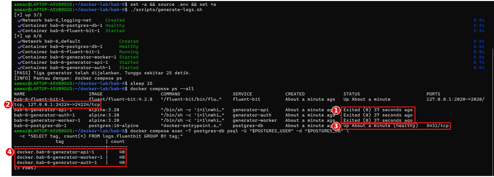

<sub>Terminal kamu: generate-logs → ps --all → hitung log per tag</sub>

#### B. Jelaskan (ikuti nomor merah)

**[1]**  "Tiga generator statusnya **Exited (0)**. Itu normal: tugasnya cuma mencetak 20 log lalu selesai. Angka 0 artinya selesai tanpa error."

**[2]**  "Fluent Bit membuka port **127.0.0.1:24224**. Ke port inilah **Docker Engine** mengirim log dari generator."

**[3]**  "PostgreSQL **healthy** dan hanya **5432/tcp** tanpa panah, jadi database tidak dibuka ke luar, hanya bisa diakses dari network internal."

**[4]**  "Di tabel **logs.fluentbit** tiap generator punya **40** baris, karena script saya jalankan dua kali × 20 log. Ini bukti log sampai."

#### Perjalanan 1 baris log (4 langkah)

| # | Siapa | Apa yang terjadi |
|---|---|---|
| 1 | Generator | echo log JSON ke stdout |
| 2 | Docker Engine | menangkap stdout (logging driver fluentd), kirim ke 127.0.0.1:24224 |
| 3 | Fluent Bit | terima (input forward), simpan dulu di buffer filesystem |
| 4 | PostgreSQL | output pgsql menulis ke logs.fluentbit (kolom tag, time, data JSONB) |

> 🔑 **Kata kunci:** generator stdout → Docker Engine → 127.0.0.1:24224 → Fluent Bit buffer → postgres-db logs.fluentbit

> 🗣️ **Contoh penjelasan:** Generator mencetak log ke stdout. Docker Engine menangkapnya lewat logging driver fluentd dan mengirim ke 127.0.0.1:24224, port Fluent Bit. Fluent Bit menyimpannya dulu di buffer, lalu menulis ke tabel logs.fluentbit di PostgreSQL. Buktinya tiap generator ada 40 baris.

#### C. Pertanyaan lanjutan: kalau fluentd-address diganti fluent-bit:24224?

"Log tidak terkirim. Yang mengirim log itu **Docker Engine**, bukan container. Docker Engine ada **di luar network Compose**, jadi tidak kenal nama service **fluent-bit**. Nama itu hanya dikenal antar container di network yang sama, misalnya Fluent Bit ke postgres-db. Karena itu dipakai 127.0.0.1:24224."

> 📘 **Sumber perintah:** Jawaban lanjutan ini **tertulis di cheatsheet Bab 6, bagian Arsitektur Ringkas**: "Docker Engine—bukan container generator—menjalankan logging driver ... fluentd-address menunjuk port collector yang dipublikasikan pada host (127.0.0.1:24224), bukan nama service Compose." Boleh kamu tunjuk saat menjawab.

> 💡 Kalau dosen bilang "teman saya bisa": bisa saja kalau host-nya kebetulan bisa menerjemahkan nama itu. Tapi di lab ini yang dipakai alamat host. Dan karena fluentd-async "true", container tetap jalan walau log gagal terkirim, jadi kegagalannya tidak kelihatan.

---

## Soal 5 — Buffering saat backend mati

> 💡 **Bunyi soal (inti):** Jalankan **test-buffering.sh**, tunjukkan bahwa log tidak hilang saat PostgreSQL mati, dan jelaskan kenapa kriteria PASS bukan "tidak ada error".

#### A. Tunjukkan

```bash
./scripts/test-buffering.sh
docker compose logs --tail 200 fluent-bit
# versi disaring (lebih mudah dibaca, bukan dari cheatsheet):
docker compose logs --tail 200 fluent-bit | grep -E "warn|error|retry|succeeded" | grep -v retry_test
```

> 📘 **Sumber perintah:** cheatsheet Bab 6, **Kotak Perintah F — Menguji Buffering dan Pemulihan**. Di kotak itu juga ada kalimat kunci: "Kriteria utama bukan bahwa tidak ada pesan galat, melainkan bahwa kegagalan output terlihat, service collector tetap berjalan, dan jumlah record bertambah". Buffer: **Kotak Script 5 — fluent-bit.conf** (storage.type filesystem, storage.path).

> 💡 Tanpa grep, outputnya panjang dan bercampur log generator. Kalau dosen minta persis seperti cheatsheet, jalankan yang tanpa grep lalu scroll ke baris [error] / [ warn].

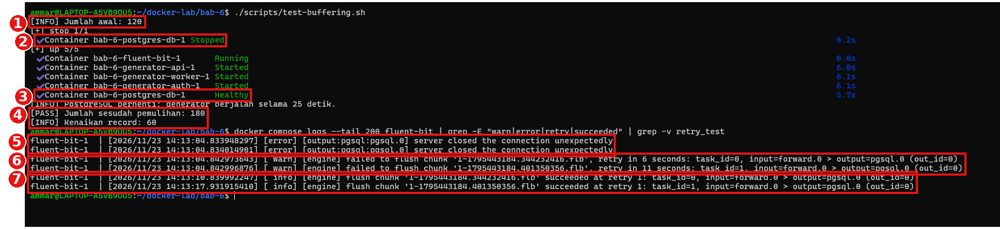

<sub>Terminal kamu: hasil test-buffering dan log Fluent Bit</sub>

#### B. Jelaskan (ikuti nomor merah)

**[1]**  "Sebelum tes jumlah record **120**."

**[2]**  "Script **mematikan PostgreSQL**, lalu generator dijalankan lagi."

**[3]**  "PostgreSQL **hidup lagi** (Healthy)."

**[4]**  "Sesudah pulih jumlahnya **180**, naik **60** = 3 generator × 20 log. Tidak ada yang hilang."

**[5]**  "Saat DB mati, output **pgsql.0** (nama output ke PostgreSQL) gagal: **server closed the connection**."

**[6]**  "Fluent Bit tidak membuang data: **failed to flush chunk**, lalu dijadwalkan **retry in 6 / 11 seconds**. Chunk-nya ditahan di buffer filesystem (diatur di fluent-bit.conf, volume flb-storage)."

**[7]**  "Setelah DB hidup: **succeeded at retry 1**. Kedua chunk berhasil dikirim."

> 🔑 **Kata kunci:** 120 → DB mati → error → failed to flush → retry → succeeded → 180 (+60)

> 🗣️ **Contoh penjelasan:** Awalnya 120. PostgreSQL dimatikan, jadi output pgsql gagal dan muncul error. Fluent Bit tidak membuang datanya, chunk ditahan di buffer lalu dicoba lagi. Setelah database hidup, retry berhasil dan jumlah jadi 180, naik 60, sama dengan log yang dibuat generator.

#### C. Pertanyaan lanjutan: kenapa PASS bukan "tidak ada error"?

"Karena saat database mati, error **memang harus muncul**. Seperti alarm kebakaran: kalau ada api tapi alarm diam, itu justru bahaya. Kriteria yang benar: **kegagalan terlihat**, **Fluent Bit tetap hidup**, dan **data bertambah** setelah pulih."

> ⚠️ Bonus kalau ditanya kelemahan tes: rantai **depends_on** membuat Compose menyalakan lagi postgres-db saat generator dibuat ([3] Healthy 5.7s), jadi DB hanya mati sekitar 6 detik. Tesnya lebih singkat dari yang tertulis di script.

---

## Soal 13 — Status target dan makna up

> 💡 **Bunyi soal (inti):** Tunjukkan status target Prometheus, jelaskan arti **up = 1**, dan apa yang belum dibuktikan oleh up.

#### A. Tunjukkan

```bash
# browser: http://127.0.0.1:9090/targets   (atau Status > Target health)
curl -fsS http://127.0.0.1:9090/api/v1/targets | python3 -m json.tool | grep -E '"job"|"health"'
./scripts/verify-stack.sh
```

> 📘 **Sumber perintah:** **verify-stack.sh**: cheatsheet Bab 7, **Kotak Perintah C — Menjalankan Stack Monitoring**. curl targets: dari **bunyi soal** (grep hanya untuk merapikan). Kalimat kunci di cheatsheet, **Catatan Keamanan**: "up = 1 hanya membuktikan scrape berhasil; nilai tersebut tidak membuktikan fungsi bisnis sehat."

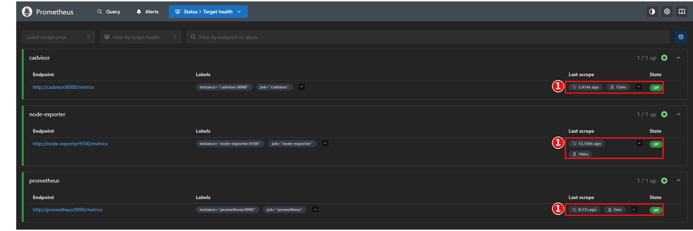

<sub>Browser kamu: halaman Targets</sub>

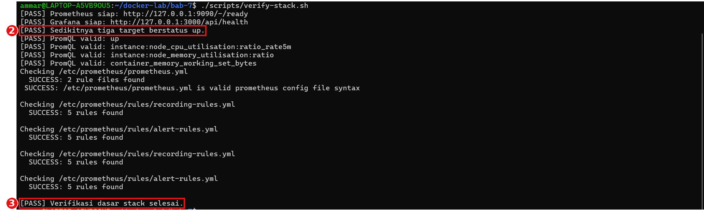

<sub>Terminal kamu: verify-stack.sh</sub>


<sub>Terminal kamu: API targets</sub>

#### B. Jelaskan (ikuti nomor merah)

**[1]**  "Tiga target (cadvisor, node-exporter, prometheus) **UP**. Kolom **Last scrape** menunjukkan kapan terakhir Prometheus mengambil metrik, misalnya 5 detik lalu. Prometheus scrape tiap 15 detik."

**[2]**  "Script verify juga bilang **sedikitnya tiga target up**."

**[3]**  "Semua pengecekan dasar **PASS**, termasuk config dan rule valid."

**[4]**  "Dari API pun sama: **health: up** untuk ketiga job."

> 🔑 **Kata kunci:** up = 1 → scrape terakhir berhasil → Prometheus bisa ambil /metrics → BUKAN bukti aplikasi sehat

> 🗣️ **Contoh penjelasan:** up = 1 artinya scrape terakhir berhasil, Prometheus bisa mengambil metriknya. Nilainya 1 kalau berhasil, 0 kalau gagal, bukan hitungan. Tapi up = 1 tidak membuktikan aplikasi melayani pengguna dengan benar.

#### C. Pertanyaan lanjutan: semua UP tapi pengguna terdampak, metrik apa?

"Butuh metrik dari aplikasi: **error rate** (berapa request gagal per waktu) dan **latency** (berapa lama pengguna menunggu). Aplikasinya harus menyediakan metrik itu. Lab ini belum punya. Contoh di PMB: semua container Up, tapi worker timeout sehingga pendaftaran FAILED. Itu baru kelihatan dari log."

---

## Soal 17 — Negative test TargetDown

> 💡 **Bunyi soal (inti):** Buktikan alert **TargetDown** bekerja dengan mematikan target, tunjukkan perubahan statusnya, dan sebutkan apa yang belum terbukti.

#### A. Tunjukkan (urutannya penting)

```bash
# 1. Prometheus Query:  ALERTS{alertname="TargetDown"}   -> kosong
docker compose stop node-exporter                       # 2
# 3-5. tunggu ~75 detik:  up{job="node-exporter"}  lalu  ALERTS{...}
docker compose start node-exporter                      # 6
# 7. tunggu ~30 detik: up = 1, ALERTS kosong lagi
```

> 📘 **Sumber perintah:** cheatsheet Bab 7, **Kotak Perintah F — Negative Test Target Down**. Cheatsheet memakai query **ALERTS{alertname="TargetDown",alertstate="firing"}** (hanya firing). Untuk melihat **pending** juga, hapus bagian alertstate seperti di screenshot-mu. Rule-nya: **Kotak Script 6 — alert-rules.yml** (expr up == 0, for: 1m).

#### B. Jelaskan (ikuti nomor merah)

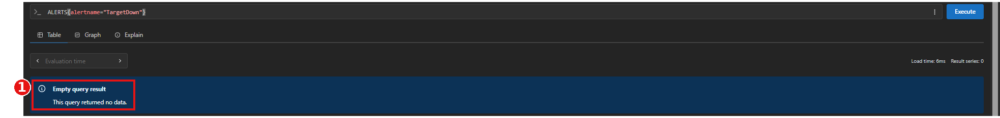

<sub>Sebelum tes</sub>

**[1]**  "Sebelum tes, alert TargetDown **kosong**: tidak ada masalah."

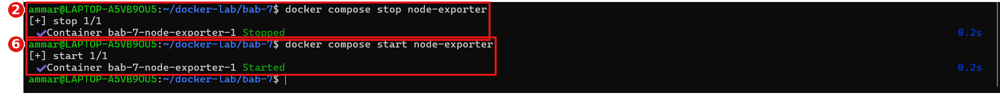

<sub>stop dan start node-exporter</sub>

**[2]**  "Saya **matikan node-exporter** (target yang mengirim metrik host)."

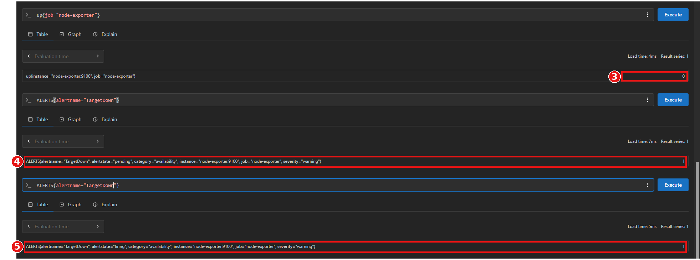

<sub>Sekitar 75 detik setelah stop</sub>

**[3]**  "Scrape gagal, jadi **up = 0**. Rule-nya **up == 0**."

**[4]**  "Alert langsung **pending**: kondisi terpenuhi, tapi masih ditunggu 1 menit (**for: 1m**) supaya tidak alarm palsu."

**[5]**  "Setelah bertahan 1 menit jadi **firing**. Makanya saya tunggu sekitar 75 detik (60 + 15 detik scrape)."

**[6]**  "(Gambar stop/start di atas) Saya **nyalakan lagi** node-exporter."

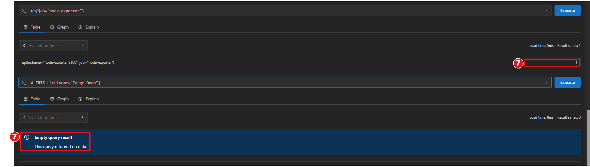

<sub>Sekitar 30 detik setelah start</sub>

**[7]**  "**up kembali 1** dan ALERTS **kosong** lagi."

> 🔑 **Kata kunci:** kosong → stop → up 0 → pending → firing → start → up 1, kosong → belum terbukti: notifikasi

> 💡 Kalau ditanya "kalau dinyalakan sebelum 1 menit?" → alert masih pending lalu batal, tidak pernah firing. Itu gunanya for: 1m. Ingat: **0 ≠ kosong**. up = 0 artinya ada data, nilainya gagal. ALERTS kosong artinya tidak ada alert.

#### C. Pertanyaan lanjutan: bagian alerting yang belum terbukti?

| Rantai alert | Terbukti? |
|---|---|
| Prometheus mendeteksi up = 0 | Ya |
| pending → firing | Ya |
| Notifikasi terkirim (email/chat) | Belum: lab tidak punya Alertmanager |
| Sampai ke orang yang tepat | Belum |
| Ada yang merespons | Belum |

"Dan kalau Prometheus sendiri mati, tidak ada yang memberi alert."

---

## Soal 21 — Tahap A: baseline transaksi normal

> 💡 **Bunyi soal (inti):** Pastikan mode insiden **none**, kirim satu pendaftaran normal, lalu buktikan statusnya dan kronologinya di centralized log. Jelaskan event time vs waktu collector.

#### A. Tunjukkan

```bash
cd ~/pmb-devsecops-lab && set -a && source .env && set +a
./scripts/set-incident.sh none
./scripts/demo-normal.sh
RID=REQ-...            # salin Request ID dari output, JANGAN tulis REQ-ID-KAMU
sed "s/REQ-GANTI-DENGAN-NILAI-AKTUAL/$RID/" queries/incident-analysis.sql \
  | docker compose exec -T log-db psql -U "$LOG_DB_ADMIN_USER" -d "$LOG_DB_NAME" --file=/dev/stdin
```

> 📘 **Sumber perintah:** PMB **README.md**: **Skenario 1 — Alur normal** (demo-normal.sh, set-incident.sh none) dan **Menelusuri request ID** (query app-db dan incident-analysis.sql). README menyuruh mengubah variabel di file SQL; perintah **sed** di atas melakukan hal yang sama tanpa mengedit file. Soal ini = **docs/SCENARIO.md, Tahap A — Baseline**.

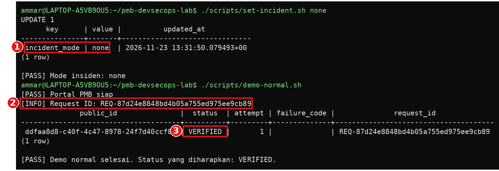

<sub>Terminal kamu: set-incident none dan demo-normal</sub>

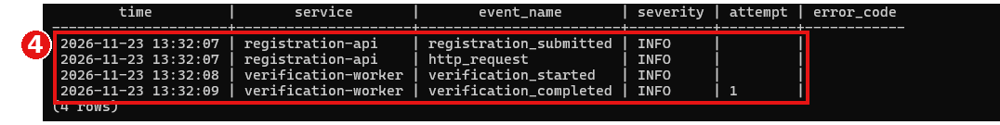

<sub>Screenshot kamu: Query 4 (kronologi satu Request ID) dari log-db</sub>

#### B. Jelaskan (ikuti nomor merah)

**[1]**  "Mode insiden **none**, jadi ini kondisi normal."

**[2]**  "Satu pendaftaran dikirim. **Request ID** ini yang saya pakai untuk melacak di semua log."

**[3]**  "Di database aplikasi (app-db) statusnya **VERIFIED**, attempt 1."

**[4]**  "Di centralized log (log-db), Query 4: **registration_submitted → verification_started → verification_completed**, dari 13:32:07 sampai 13:32:09, sekitar 2 detik. Ini baseline untuk dibandingkan dengan insiden nanti."

#### Bukti tambahan (kalau ditanya "buktikan dua database terhubung" atau soal waktu)

```bash
docker compose exec -T app-db psql -U "$APP_DB_ADMIN_USER" -d "$APP_DB_NAME" \
  -c "SELECT public_id, status, attempt, request_id FROM registrations ORDER BY submitted_at DESC LIMIT 3;"
```

> 📘 **Sumber perintah:** PMB **README.md**, bagian **Menelusuri request ID** (query app-db; di README tanpa LIMIT). Query event_time di bawah tidak ada di README.

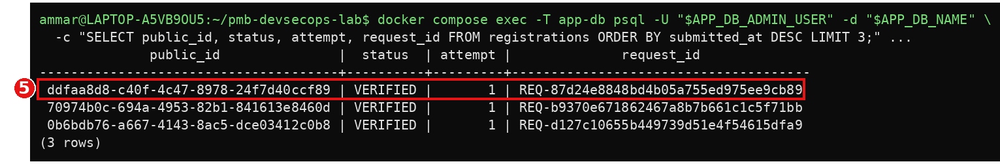

<sub>Terminal kamu: app-db</sub>

**[5]**  "Request ID yang **sama** ada di app-db dan di log-db. Itu yang menghubungkan transaksi dengan log-nya."

```bash
docker compose exec -T log-db psql -U "$LOG_DB_ADMIN_USER" -d "$LOG_DB_NAME" -c \
"SELECT time, (data->>'log')::jsonb->>'timestamp' AS event_time, (data->>'log')::jsonb->>'event' AS event
 FROM logs.fluentbit WHERE data->>'log' LIKE '%$RID%' ORDER BY 2;"
```

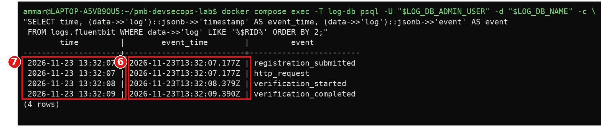

<sub>Terminal kamu: event_time vs time</sub>

**[6]**  "**event_time** = waktu yang ditulis aplikasi saat kejadian, sampai **milidetik** (.177Z), UTC."

**[7]**  "**time** = waktu dari collector (Docker/Fluent Bit), hanya sampai **detik**. Dua event di 13:32:07 urutannya tidak pasti kalau pakai kolom ini."

> 🔑 **Kata kunci:** none → Request ID → VERIFIED (app-db) → kronologi (log-db) → event_time ms vs time detik

> 🗣️ **Contoh penjelasan:** Mode none, saya kirim satu pendaftaran. Di app-db statusnya VERIFIED. Dengan Request ID yang sama, di log-db terlihat kronologinya: submitted, started, completed, sekitar 2 detik. Ini baseline normal.

#### C. Pertanyaan lanjutan: event time vs waktu collector vs waktu database?

| Waktu | Dari mana | Presisi |
|---|---|---|
| Event time | field timestamp di log, dibuat aplikasi | milidetik [6] |
| Waktu collector | kolom time (Docker/Fluent Bit) | detik [7] |
| Waktu simpan DB | saat baris masuk database; bisa telat kalau tertahan di buffer | tidak dicatat di tabel |

"Untuk kronologi pakai **event time**, karena paling dekat dengan kejadian dan sampai milidetik, asalkan jam semua server sinkron (NTP)."

> 💡 Request ID di PDF ini (REQ-87d2...) dari latihanmu tadi malam. Saat ujian ID-nya pasti beda. Itu normal, pakai ID dari run saat itu.

---

## Ringkasan 1 halaman — baca sebelum masuk

| Soal | Kata kunci (ucapkan berurutan) |
|---|---|
| 1 | generator stdout → Docker Engine → 127.0.0.1:24224 → Fluent Bit buffer → logs.fluentbit (40 per tag) |
| 1 lanjutan | fluent-bit:24224 tidak bisa: Docker Engine di luar network Compose, tidak kenal nama service |
| 5 | 120 → DB mati → error → failed to flush → retry → succeeded → 180 (+60) |
| 5 lanjutan | error harus muncul; PASS = gagal terlihat + Fluent Bit hidup + data bertambah |
| 13 | up 1 = scrape terakhir berhasil; Last scrape; bukan bukti aplikasi sehat |
| 13 lanjutan | error rate + latency, dari aplikasi; lab belum punya; contoh PMB timeout |
| 17 | kosong → stop → up 0 → pending → firing → start → up 1, kosong |
| 17 lanjutan | for: 1m cegah alarm palsu; tanpa Alertmanager notifikasi belum terbukti |
| 21 | none → Request ID → VERIFIED → kronologi log-db (~2 detik) |
| 21 lanjutan | event_time ms (aplikasi) vs time detik (collector) vs waktu simpan; pakai event time + NTP |

> 💡 Kalau lupa kalimatnya: tunjuk bukti di layar, sebut angkanya, lalu bilang "artinya ...". Itu sudah cukup untuk mulai.
