# Paket B — Naskah Demo + Evidence

*Soal 2, 6, 11, 16, 22 • disusun dari screenshot dan terminal kamu sendiri • perintah dicocokkan dengan cheatsheet*

**Cara pakai.** Tiap soal: **A. Tunjukkan** (jalankan perintah), **B. Jelaskan** (ikuti nomor merah di gambar), **C. Jawab lanjutan**. 📘 = di mana perintah itu ada di cheatsheet/README, jadi besok tinggal salin. 🟧 = soal yang belum pernah kamu jalankan.

| Soal | Lab / tab | Status | Satu kalimat inti |
|---|---|---|---|
| 2 | Bab 6 (Tab 2) | sudah | Semua (container_name, source, log) ada di kolom data (JSONB). |
| 6 | Bab 6 (Tab 2) | sudah | Health = hidup; metrics = buku catatan; bandingkan input vs output. |
| 11 | Bab 7 (Tab 1) | sudah | Cuma 9090 & 3000 di 127.0.0.1; exporter internal lewat nama service. |
| 16 | Bab 7 (Tab 1) | sudah | Container ±0,47 core ÷ 16 core ≈ 3% CPU host. |
| 22 | PMB (Tab 3) | sudah (Jumat) | Worker yang pertama WARN; retry 1-2-3 lalu timeout; status FAILED. |

> ⚠️ Bab 6 dan PMB **tidak bisa hidup bersamaan** (port 24224 dan 2020 sama). Kerjakan soal Bab 6 dulu, lalu **docker compose down** di Bab 6, baru **docker compose up -d** di PMB. Bab 7 boleh hidup terus.

---

## Soal 2 — Verifikasi record dan JSONB

> 💡 **Demonstrasi:** Jalankan query distribusi per tag dari **queries/analysis.sql** dan **SELECT pg_typeof(data), count(*) FROM logs.fluentbit GROUP BY pg_typeof(data);**. Jelaskan di mana container_name, source, dan isi log aplikasi disimpan.  
> **Pertanyaan lanjutan:** Bagaimana membuat severity bisa di-query sebagai field tersendiri?

#### A. Tunjukkan

```bash
set -a
source .env
set +a
docker compose exec -T postgres-db \
  psql --username "$POSTGRES_USER" --dbname "$POSTGRES_DB" \
  --file /dev/stdin < queries/analysis.sql
```

> 📘 **Sumber perintah:** cheatsheet Bab 6, **Kotak Perintah E — Memverifikasi Record PostgreSQL**.

```bash
docker compose exec -T postgres-db \
  psql --username "$POSTGRES_USER" --dbname "$POSTGRES_DB" \
  --command 'SELECT pg_typeof(data), count(*) FROM logs.fluentbit GROUP BY pg_typeof(data);'
```

> 📘 **Sumber perintah:** cheatsheet Bab 6, di bawah **Tabel Verifikasi PASS/FAIL**: kalimat "Verifikasi tipe data dapat dilakukan dengan".

#### B. Jelaskan (ikuti nomor merah)

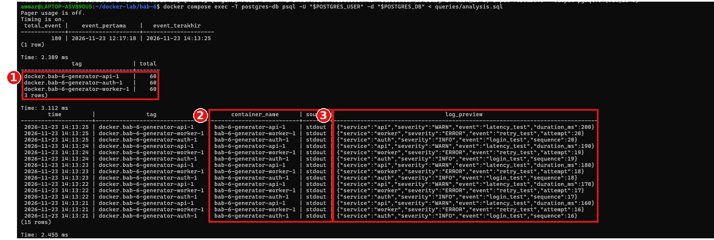

<sub>Terminal kamu: analysis.sql query 1–3</sub>

**[1]**  "Query distribusi per tag: tiga generator masing-masing **60** record (3 kali run × 20 log)."

**[2]**  "**container_name** dan **source** ditambahkan oleh **Docker**."

**[3]**  "Isi log aplikasi ada di label **log**. Ketiganya disimpan di **kolom data**. Di sini terlihat seperti kolom sendiri karena query mengambilnya dengan **data ->> '...'**."

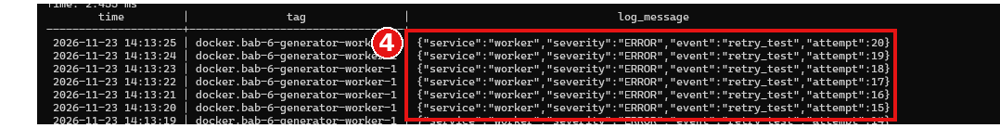

<sub>Terminal kamu: analysis.sql query 4 (pencarian severity)</sub>

**[4]**  "Query 4 mencari severity ERROR pakai **ILIKE** (mencari teks), karena severity masih **terselip di dalam string log**."

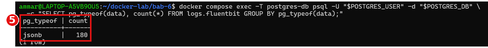

<sub>Terminal kamu: pg_typeof</sub>

**[5]**  "Semua **180** record kolom data bertipe **jsonb**."

> 🔑 **Kata kunci:** tabel logs.fluentbit → 3 kolom tag/time/data → data = JSONB → container_name + source dari Docker, log dari aplikasi

> 🗣️ **Contoh penjelasan:** Tabelnya punya tiga kolom: tag, time, dan data. container_name, source, dan isi log semuanya ada di kolom data yang bertipe JSONB, buktinya pg_typeof jsonb untuk 180 baris. container_name dan source ditambahkan Docker, isi log aplikasi ada di label log.

#### C. Pertanyaan lanjutan: severity jadi field sendiri?

"Sekarang severity belum bisa di-query langsung, karena masih terselip di label log sebagai teks. Supaya jadi field sendiri, log-nya harus di-**parse**, artinya dirapikan dan dipisah per field. Cara **sementara** saat query: **(data->>'log')::jsonb->>'severity'**, data di tabel tidak berubah. Cara **yang lebih baik**: pasang **parser JSON di Fluent Bit**, supaya sebelum disimpan severity sudah jadi field sendiri."

Bonus (kalau mau membuktikan cara sementara):

```bash
docker compose exec -T postgres-db \
  psql --username "$POSTGRES_USER" --dbname "$POSTGRES_DB" \
  --command "SELECT (data->>'log')::jsonb->>'severity' AS severity, count(*) FROM logs.fluentbit GROUP BY 1;"
```

Harapannya ERROR, INFO, WARN masing-masing sama jumlahnya. Perintah bonus ini tidak ada di cheatsheet.

> 💡 Kata "parser" ada di materi Bab 6 (bab-06.md). Parse = merapikan yang awalnya satu kalimat jadi field-field. Isinya tidak hilang, cuma bentuknya berubah.

---

## Soal 6 — Monitoring collector

> 💡 **Demonstrasi:** Jalankan **curl -fsS http://127.0.0.1:2020/api/v1/health** dan **curl -fsS http://127.0.0.1:2020/api/v1/metrics**. Jelaskan arti angka-angka pada metrics.  
> **Pertanyaan lanjutan:** Health OK tetapi tabel tidak bertambah. Metric mana yang Anda lihat pertama kali?

#### A. Tunjukkan

```bash
curl -fsS http://127.0.0.1:2020/api/v1/health
curl -fsS http://127.0.0.1:2020/api/v1/metrics
```

> 📘 **Sumber perintah:** cheatsheet Bab 6, **Kotak Perintah D — Memeriksa Monitoring Fluent Bit**. Biar rapi, tambahkan di belakang perintah kedua: **| python3 -m json.tool**. Untuk melihat kode HTTP: **curl -s -o /dev/null -w 'HTTP %{http_code}\n' http://127.0.0.1:2020/api/v1/health**.

#### B. Jelaskan (ikuti nomor merah)

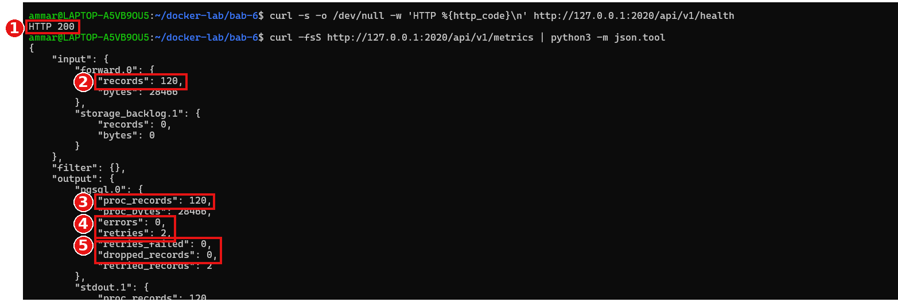

<sub>Terminal kamu: health dan metrics</sub>

**[1]**  "Health menjawab **HTTP 200**: Fluent Bit hidup."

**[2]**  "Input **forward.0 records 120**: log yang **diterima** dari Docker sejak Fluent Bit terakhir menyala."

**[3]**  "Output **pgsql.0 proc_records 120**: log yang **berhasil dikirim** ke PostgreSQL. Sama dengan input, jadi semuanya terkirim."

**[4]**  "**errors 0**, **retries 2**: ada 2 kali coba ulang, itu dari tes buffering waktu PostgreSQL dimatikan."

**[5]**  "**retries_failed 0** dan **dropped_records 0**: tidak ada yang menyerah atau dibuang, artinya **tidak ada log hilang**."

| Angka | Analogi kurir paket |
|---|---|
| input records | paket diterima |
| proc_records | paket berhasil diantar |
| errors / retries | gagal antar / coba antar lagi |
| retries_failed / dropped | paket menyerah / dibuang = data hilang |

> 💡 Kenapa 120 padahal di database 180? Angka metrics **dihitung sejak Fluent Bit terakhir menyala** dan kembali ke 0 kalau container restart.

> 🔑 **Kata kunci:** port 2020 → health (hidup?) → metrics (buku catatan) → input vs output → beda di mana = masalah di mana

#### C. Pertanyaan lanjutan: health OK tapi tabel tidak bertambah?

"Yang saya lihat pertama: bandingkan **input records** dengan **output pgsql proc_records**. Kalau **input tidak naik**, log tidak pernah sampai ke Fluent Bit, jadi masalahnya **sebelum** Fluent Bit: generator, logging driver Docker, atau alamat 127.0.0.1:24224. Kalau **input naik tapi output tidak**, Fluent Bit sudah terima tapi gagal kirim, jadi masalahnya di **koneksi ke PostgreSQL**. Itu dicek dari errors, retries, retries_failed, lalu docker compose logs fluent-bit."

Cara membuktikan "bertambah": ambil metrics **sebelum dan sesudah** generate-logs:

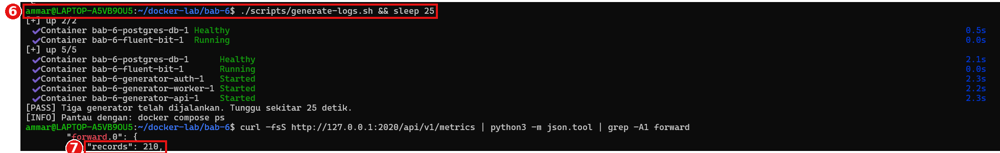

<sub>Terminal kamu: generate-logs lalu metrics lagi</sub>

**[6]**  "Saya buat log baru dengan generate-logs."

**[7]**  "Input naik jadi **210**. Artinya Docker berhasil mengirim ke Fluent Bit."

> 💡 Kenaikannya 90, bukan 60. Kemungkinan ada run lain di antara dua pengecekan. Itu sebabnya angka "sebelum" harus diambil **tepat sebelum** generate. Yang paling penting: input = proc_records dan dropped = 0.

---

## Soal 11 — Arsitektur dan exposure stack

> 💡 **Demonstrasi:** Jalankan **docker compose ps** dan **ss -lntp**. Jelaskan port mana yang terbuka ke host dan bagaimana Prometheus menjangkau exporter.  
> **Pertanyaan lanjutan:** Mengapa cAdvisor memakai **privileged: true**, dan di mesin seperti apa itu tidak boleh dijalankan?

#### A. Tunjukkan

```bash
docker compose ps
ss -lntp
```

> 📘 **Sumber perintah:** **docker compose ps**: cheatsheet Bab 7, Kotak Perintah C. **ss -lntp**: tidak ada di cheatsheet Bab 7 (hanya disebut di tabel troubleshooting Bab 6), jadi **ketik sendiri**. Bukti nama service: cheatsheet Bab 7, **Kotak Script 4 — prometheus/prometheus.yml**, baris **targets: - node-exporter:9100**.

#### B. Jelaskan (ikuti nomor merah)

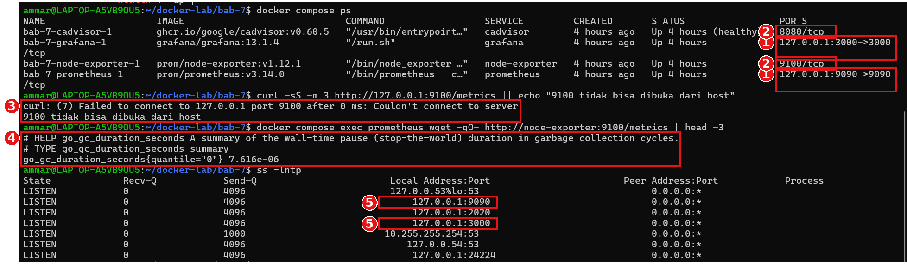

<sub>Terminal kamu: ps, bonus curl/wget, ss -lntp</sub>

**[1]**  "Kolom PORTS: hanya **Grafana 127.0.0.1:3000->3000** dan **Prometheus 127.0.0.1:9090->9090**. Ada tanda **->** = dibuka ke host, tapi hanya di 127.0.0.1, jadi tidak bisa dibuka dari laptop lain."

**[2]**  "**cAdvisor 8080/tcp** dan **Node Exporter 9100/tcp** tidak ada tanda ->, jadi **sengaja tidak dibuka** ke host, hanya internal."

**[3]**  (bonus) "Dari laptop, 9100 **gagal** dibuka."

**[4]**  (bonus) "Dari dalam container Prometheus, **node-exporter:9100 berhasil**. Prometheus menjangkau exporter lewat **network internal** pakai **nama service**, sesuai prometheus.yml."

**[5]**  "ss -lntp menampilkan port yang sedang **LISTEN** di host (pintu terbuka, menunggu koneksi): ada **9090** dan **3000** di 127.0.0.1. 9100 dan 8080 **tidak ada**."

> 💡 Abaikan baris :53 (DNS sistem WSL). Baris 2020 dan 24224 adalah Fluent Bit Bab 6. Kalau ditanya kenapa kolom Process kosong: "port dibuka Docker, bukan program milik user saya, jadi tidak terlihat tanpa sudo."

Bonus perintah [3] dan [4] (tidak ada di cheatsheet):

```bash
curl -sS -m 3 http://127.0.0.1:9100/metrics || echo "9100 tidak bisa dibuka dari host"
docker compose exec prometheus wget -qO- http://node-exporter:9100/metrics | head -3
```

> 🔑 **Kata kunci:** -> = dibuka → cuma 9090 & 3000 di 127.0.0.1 → 9100 & 8080 internal → Prometheus lewat nama service (prometheus.yml)

> 🗣️ **Contoh penjelasan:** Yang terbuka ke host cuma Prometheus 9090 dan Grafana 3000, dan hanya di 127.0.0.1. Node Exporter dan cAdvisor sengaja tidak dibuka, karena metriknya bisa membocorkan info mesin. Prometheus menjangkau mereka lewat network internal pakai nama service, seperti tertulis di prometheus.yml: node-exporter:9100.

#### C. Pertanyaan lanjutan: kenapa cAdvisor privileged?

"cAdvisor harus **melihat semua container** di host, jadi butuh akses hampir seperti **root**. Analoginya kunci master hotel. Tidak boleh dijalankan di mesin yang **penting atau sensitif**: server produksi, server yang dipakai bersama, atau laptop yang ada data sensitif. Kalau cAdvisor dibobol, penyerang bisa menguasai seluruh mesin."

> 📘 **Sumber perintah:** cheatsheet Bab 7, **Catatan Keamanan**: "cAdvisor yang privileged memiliki visibilitas luas terhadap host..."

---

## Soal 16 — Load test dan denominator CPU

> 💡 **Demonstrasi:** Jalankan **docker compose --profile load up -d load-generator**, amati CPU container dan CPU host selama 2 menit, lalu hentikan generator. Jelaskan angka yang Anda lihat.  
> **Pertanyaan lanjutan:** Bagaimana Anda membuktikan kenaikan CPU host berasal dari load generator, bukan proses lain?

#### A. Tunjukkan

```bash
docker compose --profile load up -d load-generator
# Prometheus (Query), amati >= 2 menit:
container:cpu_usage_cores:rate1m{name=~".*load-generator.*"}
ALERTS{alertname="ContainerHighCPU"}
instance:node_cpu_utilisation:ratio_rate5m * 100      # CPU host
# selesai:
docker compose --profile load stop load-generator
docker compose --profile load rm -f load-generator
```

> 📘 **Sumber perintah:** cheatsheet Bab 7, **Kotak Perintah E — Menguji Beban Container**. Query CPU host dari **Kotak Perintah D**. Atau lihat dashboard Grafana **Bab 7 — Resource Monitoring**.

#### B. Jelaskan (ikuti nomor merah)

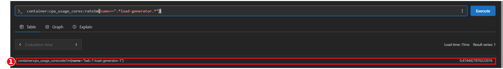

<sub>Prometheus kamu (Sabtu): CPU load generator</sub>

**[1]**  "Load generator memakai sekitar **0,47 core**. Mendekati batas **cpus: 0.50**, jadi limit CPU berlaku."

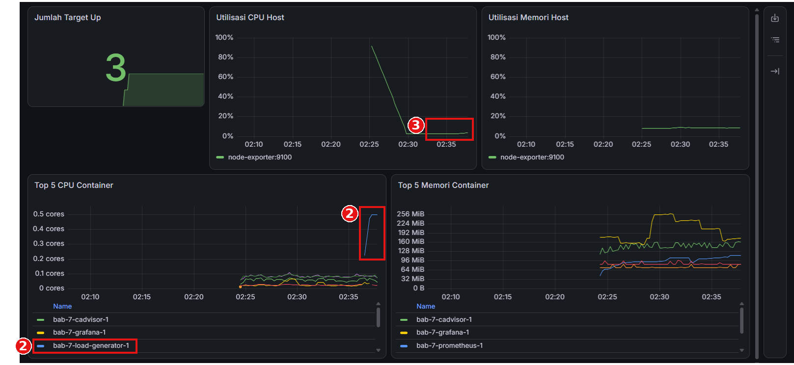

<sub>Grafana kamu (Sabtu): dashboard saat load</sub>

**[2]**  "Di panel Top 5 CPU Container, **bab-7-load-generator-1** langsung naik ke sekitar 0,5 core."

**[3]**  "Tapi **CPU host** hanya naik sedikit (beberapa persen). Karena 0,5 core **dibagi semua core** laptop, dan dirata-rata 5 menit."

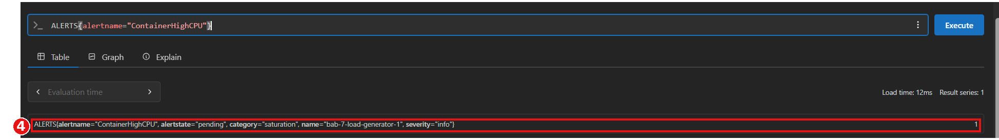

<sub>ContainerHighCPU pending</sub>

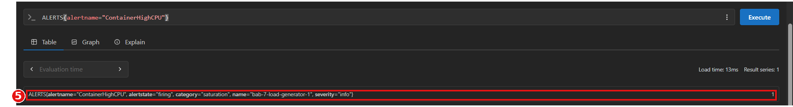

<sub>ContainerHighCPU firing</sub>

**[4]**  "Alert **ContainerHighCPU** jadi **pending**..."

**[5]**  "...lalu **firing** setelah melewati durasi for-nya."

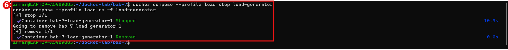

<sub>Terminal kamu: stop dan remove</sub>

**[6]**  "Setelah selesai, load generator dihentikan dan dihapus."

```bash
count(node_cpu_seconds_total{mode="idle"})      # Prometheus: jumlah core
```

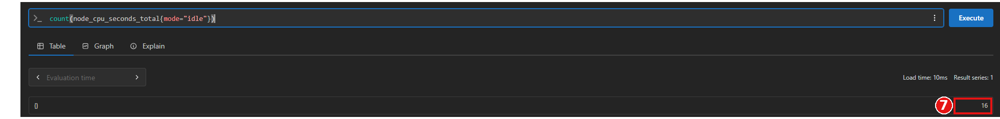

<sub>Prometheus kamu (24 Nov): jumlah core laptop</sub>

**[7]**  "Laptop saya punya **16 core**. Jadi 0,47 core ÷ 16 core ≈ **3%** CPU host. Itu sebabnya CPU host hampir tidak naik."

| Hitungan (denominator) | Hasil |
|---|---|
| Laptop kamu: 16 core, container pakai 0,47 core | 0,47 / 16 ≈ 3% CPU host |

> 🔑 **Kata kunci:** 0,47 core ≈ limit 0,5 → CPU host kecil → 0,5 dibagi jumlah core + rata-rata 5m → jangan samakan core dengan % host

> 🗣️ **Contoh penjelasan:** Load generator memakai sekitar 0,47 core, mendekati batas 0,5, jadi limit berlaku. CPU host hanya naik sedikit karena 0,5 core dibagi semua core laptop. Jadi core container tidak sama dengan persentase seluruh host.

#### C. Pertanyaan lanjutan: membuktikan kenaikan dari load generator?

- **Waktu**: CPU naik saat generator dinyalakan, turun saat dimatikan. Bisa diulang on/off.

- **Per container** (cAdvisor): load-generator ada di urutan teratas Top 5 CPU.

- **Hitungan**: kenaikan CPU host kira-kira 0,47 core dibagi jumlah core.

- **Baseline**: bandingkan dengan sebelum load test (dashboard sebelum load).

---

## Soal 22 — Tahap B — Failure injection mode timeout

> 💡 **Demonstrasi:** Aktifkan mode **timeout** dan kirim pendaftaran baru. Tanpa membuka kode aplikasi, temukan service pertama yang menghasilkan WARN atau ERROR, rekonstruksi urutan verification_started, verification_retry, dan dependency_timeout, lalu buktikan dampaknya pada status transaksi.  
> **Pertanyaan lanjutan:** Mengapa status container Up tidak membuktikan fungsi bisnis sehat?

#### A. Tunjukkan

```bash
cd ~/pmb-devsecops-lab && set -a && source .env && set +a
./scripts/demo-incident.sh          # set timeout + kirim pendaftaran; catat Request ID
RID=REQ-...                         # salin dari output
sed "s/REQ-GANTI-DENGAN-NILAI-AKTUAL/$RID/" queries/incident-analysis.sql \
  | docker compose exec -T log-db psql -U "$LOG_DB_ADMIN_USER" -d "$LOG_DB_NAME" --file=/dev/stdin
./scripts/set-incident.sh none      # kembalikan normal
```

> 📘 **Sumber perintah:** PMB **README.md**: bagian **Skenario 2 — Timeout dependency** (demo-incident.sh, set-incident.sh timeout/none) dan **Menelusuri request ID** (query incident-analysis.sql). README menyuruh mengubah variabel di file SQL; perintah **sed** di atas melakukan hal yang sama tanpa mengedit file.

#### B. Jelaskan (ikuti nomor merah)

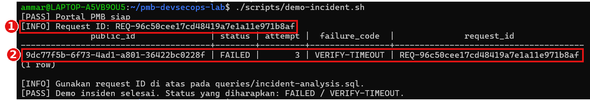

<sub>Terminal kamu (Jumat): demo-incident</sub>

**[1]**  "Mode timeout, satu pendaftaran dikirim. Ini **Request ID**-nya."

**[2]**  "Di database transaksi (app-db): status **FAILED**, attempt **3**, kode **VERIFY-TIMEOUT**. Ini dampaknya ke bisnis."

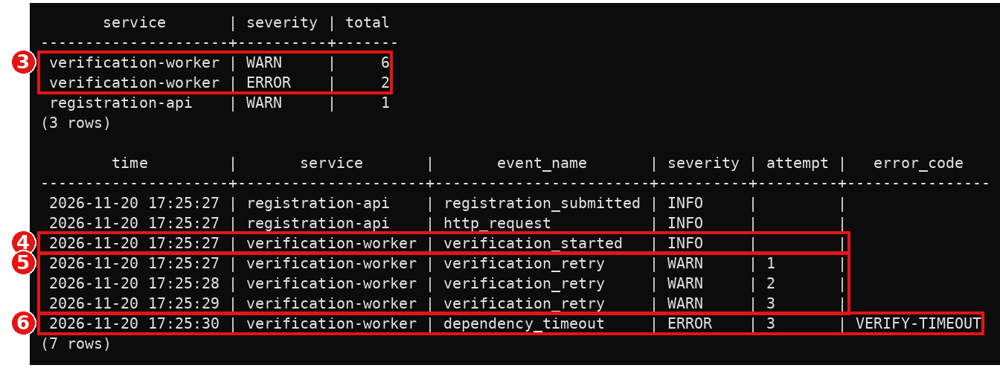

<sub>Terminal kamu (Jumat): incident-analysis query 3 dan 4</sub>

**[3]**  "Query WARN/ERROR per service: yang bermasalah **verification-worker** (WARN 6, ERROR 2), tanpa membuka kode."

**[4]**  "Kronologi: **verification_started**."

**[5]**  "Lalu **verification_retry** attempt **1, 2, 3** (WARN), tiap ±1 detik. Ini service pertama yang WARN."

**[6]**  "Terakhir **dependency_timeout** ERROR, kode **VERIFY-TIMEOUT**. Worker menyerah setelah 3 kali."

> 💡 Angka WARN 6 / ERROR 2 adalah total dari semua demo insiden yang pernah dijalankan, bukan hanya satu Request ID. registration-api WARN 1 bukan bagian kronologi ini. Kalau ditanya, cek dengan Request ID-nya.

> 🔑 **Kata kunci:** timeout → Request ID → worker WARN pertama → started → retry 1-2-3 → dependency_timeout ERROR → FAILED attempt 3

> 🗣️ **Contoh penjelasan:** Saya aktifkan mode timeout dan kirim satu pendaftaran. Tanpa membuka kode, query WARN dan ERROR menunjukkan verification-worker yang bermasalah. Kronologinya: verification_started, retry attempt 1, 2, 3, lalu dependency_timeout dengan kode VERIFY-TIMEOUT. Di database transaksi statusnya FAILED dengan attempt 3.

#### C. Pertanyaan lanjutan: container Up ≠ bisnis sehat?

"Up hanya berarti **prosesnya hidup**. Selama insiden, semua container tetap Up dan healthcheck lulus, tapi transaksinya **FAILED**. Jadi kesehatan bisnis harus dibuktikan dari **hasil transaksi** di database dan **event di log**, bukan dari status container."

> ⚠️ Jangan lupa jalankan **./scripts/set-incident.sh none** setelah soal ini, supaya mode kembali normal.

---

## Ringkasan 1 halaman — baca sebelum masuk

| Soal | Kata kunci (ucapkan berurutan) |
|---|---|
| 2 | logs.fluentbit → tag/time/data → data JSONB → container_name+source dari Docker, log dari aplikasi |
| 2 lanjutan | severity terselip di log → parse: query (sementara) / parser Fluent Bit (permanen) |
| 6 | health 200 → input 120 = proc_records 120 → retries 2 (tes buffering) → dropped 0 = tidak hilang |
| 6 lanjutan | input tidak naik = masalah sebelum Fluent Bit; input naik output tidak = koneksi PostgreSQL |
| 11 | -> = dibuka → 9090 & 3000 hanya 127.0.0.1 → 9100 & 8080 internal → nama service di prometheus.yml |
| 11 lanjutan | privileged = kunci master → jangan di produksi / server bersama / laptop data sensitif |
| 16 | 0,47 core ≈ limit 0,5 → 16 core → 0,47/16 ≈ 3% CPU host → pending → firing → stop |
| 16 lanjutan | waktu on/off, Top 5 per container, hitungan 0,47/core, baseline |
| 22 | timeout → worker WARN → started → retry 1-2-3 → dependency_timeout → FAILED attempt 3 |
| 22 lanjutan | Up = proses hidup; bisnis sehat dibuktikan dari transaksi + log |

> 💡 Kalau lupa kalimatnya: tunjuk bukti di layar, sebut angkanya, lalu bilang "artinya ...".
