# Paket C — Naskah Demo + Evidence

*Soal 3, 8, 14, 18, 23 • disusun dari screenshot dan terminal kamu sendiri • perintah dicocokkan dengan cheatsheet*

**Cara pakai.** Tiap soal: **A. Tunjukkan** (jalankan perintah), **B. Jelaskan** (ikuti nomor merah di gambar), **C. Jawab lanjutan**. 📘 = di mana perintah itu ada di cheatsheet/README, jadi besok tinggal salin. 🟧 = soal yang belum pernah kamu jalankan.

| Soal | Lab / tab | Status | Satu kalimat inti |
|---|---|---|---|
| 3 | Bab 6 (Tab 2) | sudah | Output cuma tulis Table fluentbit; schema logs dari search_path role. |
| 8 | Bab 6 (Tab 2) | sudah | Canary bocor dulu → pasang filter Lua → canary baru tidak sampai. |
| 14 | Bab 7 (Tab 1) | sudah | Counter selalu naik; rate() = laju per detik; butuh ≥ 2 sampel. |
| 18 | Bab 7 (Tab 1) | sudah | Datasource & dashboard dari file; allowUiUpdates false = UI tak bisa simpan. |
| 23 | PMB (Tab 3) | sudah | Transaksi baru VERIFIED, yang insiden tetap FAILED; usul DLQ/retry terkontrol. |

> ⚠️ Bab 6 dan PMB **tidak bisa hidup bersamaan** (port 24224 dan 2020 sama). Kerjakan soal Bab 6 dulu, lalu **docker compose down** di Bab 6, baru **docker compose up -d** di PMB. Bab 7 boleh hidup terus.

> 💡 Semua soal Paket C sudah pernah kamu jalankan.

---

## Soal 3 — Konfigurasi output PostgreSQL

> 💡 **Demonstrasi:** Tunjukkan **fluent-bit/fluent-bit.conf** dan hasil **SHOW search_path** sebagai **fluentbit_user**. Jelaskan bagaimana Fluent Bit tahu record harus ditulis ke schema logs.  
> **Pertanyaan lanjutan:** Muncul galat **relation fluentbit does not exist**. Apa saja yang Anda periksa?

#### A. Tunjukkan

```bash
cat fluent-bit/fluent-bit.conf
docker compose exec -T postgres-db \
  psql --username "$FLUENTBIT_DB_USER" --dbname "$POSTGRES_DB" \
  --command 'SHOW search_path;'
```

> 📘 **Sumber perintah:** Isi file: cheatsheet Bab 6, **Kotak Script 5 — fluent-bit/fluent-bit.conf**. Asal search_path: **Kotak Script 4 — init/01-init-logging.sh** (baris **ALTER ROLE ... SET search_path TO logs, public**). Perintah SHOW search_path tidak ada di cheatsheet, ketik sendiri (pola psql sama dengan Kotak Perintah E, user diganti $FLUENTBIT_DB_USER).

#### B. Jelaskan (ikuti nomor merah)

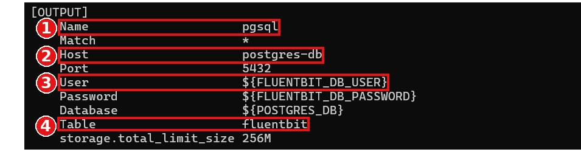

<sub>Terminal kamu (24 Nov): cat fluent-bit.conf, bagian [OUTPUT] pgsql</sub>

**[1]**  "Output **pgsql**: kirim ke PostgreSQL."

**[2]**  "**Host postgres-db**: nama service, karena Fluent Bit dan PostgreSQL ada di network Compose yang sama."

**[3]**  "Login sebagai **${FLUENTBIT_DB_USER}** = **fluentbit_user** (dari .env)."

**[4]**  "**Table fluentbit**, tanpa menyebut schema logs."

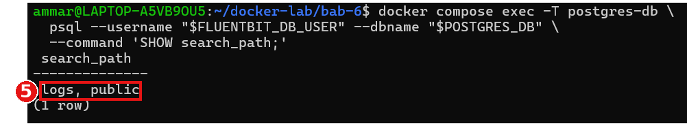

<sub>Terminal kamu (24 Nov): SHOW search_path sebagai fluentbit_user</sub>

**[5]**  "search_path untuk fluentbit_user = **logs, public**. Jadi waktu Fluent Bit menulis ke tabel bernama fluentbit, PostgreSQL mencarinya **di schema logs dulu**."

> 🔑 **Kata kunci:** Table fluentbit (tanpa schema) → login fluentbit_user → search_path logs, public (dari init script) → masuk logs.fluentbit

> 🗣️ **Contoh penjelasan:** Konfigurasi output cuma menyebut tabel fluentbit. Fluent Bit tahu harus menulis ke schema logs karena role fluentbit_user diberi search_path logs, public oleh init script. Jadi saat login sebagai fluentbit_user, nama fluentbit otomatis dicari di schema logs dulu.

> 💡 Analogi: search_path = **urutan laci** yang dibuka saat mencari berkas bernama fluentbit. Laci pertama: logs.

#### C. Pertanyaan lanjutan: relation fluentbit does not exist?

- **SHOW search_path** sebagai fluentbit_user: harus logs, public.

- **\dt logs.***: tabelnya ada atau tidak.

- Nama database dan user di fluent-bit.conf dan .env cocok atau tidak.

- Hak schema: **\dn+ logs** (fluentbit_user harus punya USAGE).

- Init script hanya jalan saat **volume database masih kosong**. Volume lama bisa jadi penyebab. Reset volume hanya kalau datanya boleh hilang.

> 📘 **Sumber perintah:** cheatsheet Bab 6, **Troubleshooting**: baris "Galat relation fluentbit does not exist" (SHOW search_path; \dt logs.*).

---

## Soal 8 — Redaction dengan nilai canary

> 💡 **Demonstrasi:** Tambahkan token sintetis (canary) ke salah satu generator, pasang filter redaction, lalu buktikan dengan query **ILIKE** bahwa nilai itu tidak sampai ke PostgreSQL.  
> **Pertanyaan lanjutan:** Selain PostgreSQL, ke mana lagi canary itu bisa bocor?

> 💡 Soal **paling berat**: mengubah konfigurasi Fluent Bit. Perintahnya tidak ada di cheatsheet, tapi **sudah berhasil kamu jalankan** (24 Nov). Salin dari halaman ini.

**Canary** = nilai palsu yang mirip token rahasia. Kalau nilai itu muncul di database, berarti redaction gagal. Analogi: uang bertanda untuk menangkap pencuri.

#### Langkah 1: bukti bocor SEBELUM ada filter

```bash
docker run --rm --log-driver fluentd \
  --log-opt fluentd-address=127.0.0.1:24224 \
  --log-opt tag=docker.canary-generator \
  alpine:3.20 echo '{"service":"auth","token":"CANARY-BEFORE-111"}'
sleep 5
docker compose exec -T postgres-db \
  psql --username "$POSTGRES_USER" --dbname "$POSTGRES_DB" \
  --command "SELECT count(*) FROM logs.fluentbit WHERE data::text ILIKE '%CANARY-BEFORE%';"
```

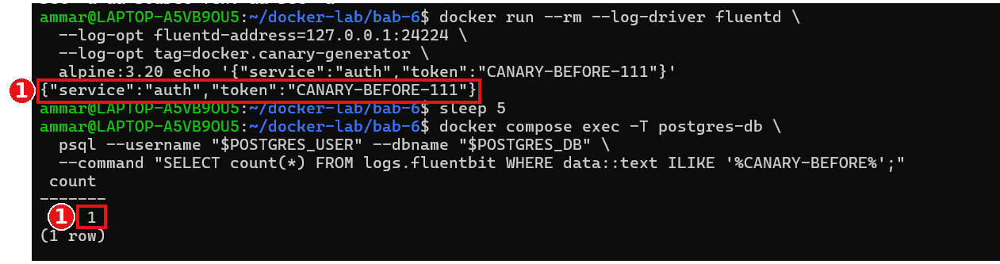

<sub>Terminal kamu (24 Nov): canary BEFORE</sub>

**[1]**  "Hasilnya **1**: token sampai ke PostgreSQL. Bocor."

#### Langkah 2: pasang filter redaction (Lua)

```bash
cat > fluent-bit/redact.lua <<'EOF'
function redact(tag, timestamp, record)
    local log = record["log"]
    if log == nil then
        return 0, timestamp, record
    end
    local clean, n = string.gsub(log, "CANARY%-[%w%-]+", "[REDACTED]")
    if n == 0 then
        return 0, timestamp, record
    end
    record["log"] = clean
    return 2, timestamp, record
end
EOF

cat >> fluent-bit/fluent-bit.conf <<'EOF'

[FILTER]
    Name    lua
    Match   *
    script  /fluent-bit/etc/redact.lua
    call    redact
EOF

sed -i '/fluent-bit.conf:ro/a\      - ./fluent-bit/redact.lua:/fluent-bit/etc/redact.lua:ro' compose.yaml
grep -n "redact.lua" compose.yaml
docker compose config --quiet && docker compose up -d --force-recreate fluent-bit
docker compose logs --tail 20 fluent-bit
```

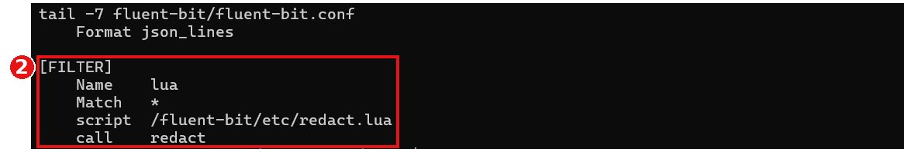

<sub>Terminal kamu (24 Nov): [FILTER] lua di akhir fluent-bit.conf</sub>

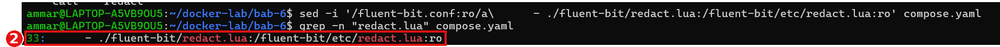

<sub>Terminal kamu (24 Nov): volume redact.lua di compose.yaml (1 baris)</sub>

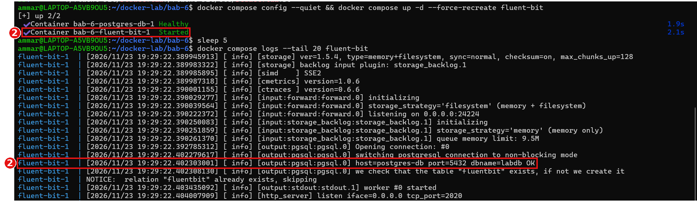

<sub>Terminal kamu (24 Nov): Fluent Bit dibuat ulang, tidak ada error lua</sub>

**[2]**  "Filter Lua mengganti pola **CANARY-...** menjadi **[REDACTED]** **sebelum** data diteruskan ke output. File Lua dipasang lewat volume, lalu Fluent Bit dibuat ulang tanpa error, koneksi pgsql OK."

> ⚠️ Jalankan sed **sekali saja**. grep harus menampilkan satu baris volume baru. Log Fluent Bit tidak boleh berisi error lua.

#### Langkah 3: bukti TIDAK bocor sesudah filter

```bash
docker run --rm --log-driver fluentd \
  --log-opt fluentd-address=127.0.0.1:24224 \
  --log-opt tag=docker.canary-generator \
  alpine:3.20 echo '{"service":"auth","token":"CANARY-AFTER-222"}'
sleep 5
docker compose exec -T postgres-db \
  psql --username "$POSTGRES_USER" --dbname "$POSTGRES_DB" \
  --command "SELECT count(*) FROM logs.fluentbit WHERE data::text ILIKE '%CANARY-AFTER%';"
docker compose exec -T postgres-db \
  psql --username "$POSTGRES_USER" --dbname "$POSTGRES_DB" \
  --command "SELECT time, data->>'log' FROM logs.fluentbit WHERE tag='docker.canary-generator' ORDER BY time;"
```

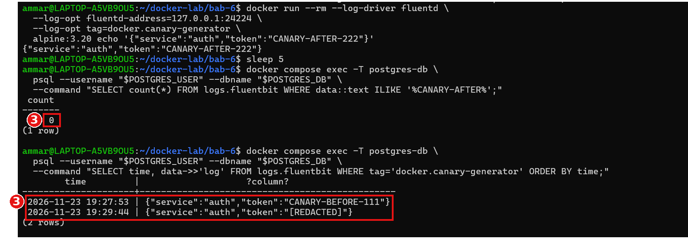

<sub>Terminal kamu (24 Nov): canary AFTER</sub>

**[3]**  "CANARY-AFTER hasilnya **0**, dan baris terbaru berisi **[REDACTED]**. Nilai sebelum dan sesudah sengaja dibedakan supaya tidak tertukar dengan data lama."

> 🔑 **Kata kunci:** canary BEFORE → ILIKE = 1 (bocor) → pasang filter Lua → canary AFTER → ILIKE = 0 + [REDACTED]

#### Kembalikan setelah selesai (opsional)

```bash
sed -i '/redact.lua/d' compose.yaml
sed -i '/^\[FILTER\]/,$d' fluent-bit/fluent-bit.conf
rm fluent-bit/redact.lua
docker compose up -d --force-recreate fluent-bit
grep -c "redact" compose.yaml fluent-bit/fluent-bit.conf
```

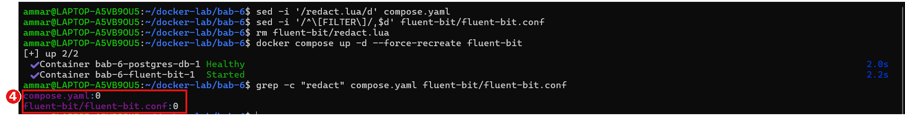

<sub>Terminal kamu (24 Nov): lab dikembalikan, redact = 0</sub>

**[4]**  "Lab sudah saya kembalikan seperti semula: tidak ada lagi redact di kedua file."

#### C. Pertanyaan lanjutan: ke mana lagi canary bisa bocor?

- **Cache log Docker** (docker logs): belum melewati filter Fluent Bit.

- **Output stdout** Fluent Bit / log internal container.

- **Sumbernya**: kode, compose.yaml, .env, riwayat terminal.

- **Turunan data**: ekspor, laporan, screenshot, backup database, hasil query Grafana.

- Jadi redaction terbaik **sedekat mungkin dengan sumber** (seperti fungsi redact di aplikasi PMB), lalu dicek lagi di collector.

---

## Soal 14 — Counter dan rate()

> 💡 **Demonstrasi:** Di Prometheus Graph, jalankan **node_cpu_seconds_total{mode="idle"}** mentah, lalu **rate(node_cpu_seconds_total[5m])**. Jelaskan perbedaan kedua grafik.  
> **Pertanyaan lanjutan:** Sesaat setelah stack dinyalakan, query rate(...[5m]) kosong. Mengapa?

#### A. Tunjukkan (Prometheus → Query → tab Graph)

```bash
node_cpu_seconds_total{mode="idle"}
rate(node_cpu_seconds_total{mode="idle"}[5m])
```

> 📘 **Sumber perintah:** cheatsheet Bab 7, **Kotak Perintah D — Query PromQL Dasar** (paragraf terakhir menjelaskan kenapa rate() dipakai pada counter). Rumus rule-nya di **Kotak Script 5 — recording-rules.yml**.

#### B. Yang terlihat dan cara menjelaskannya

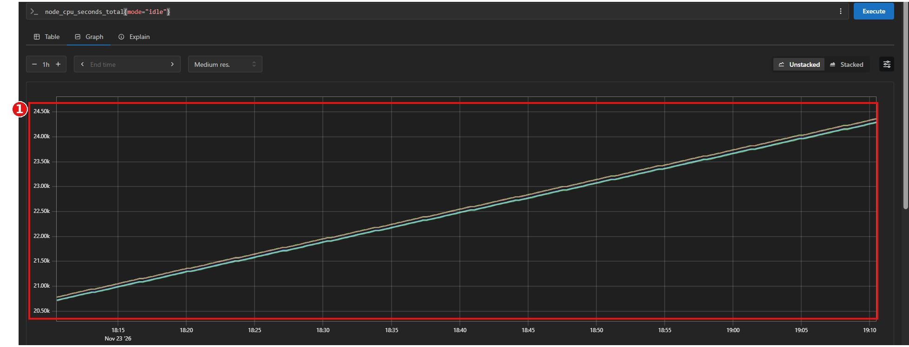

<sub>Prometheus kamu (24 Nov): node_cpu_seconds_total{mode="idle"}, tab Graph, 1 jam</sub>

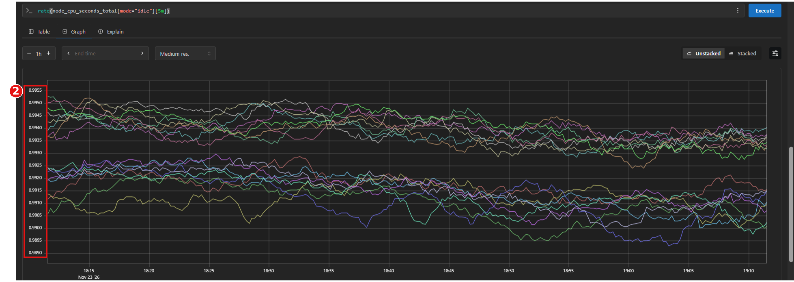

<sub>Prometheus kamu (24 Nov): rate(...[5m]), tab Graph, 1 jam</sub>

| Grafik | Bentuk | Arti |
|---|---|---|
| [1] node_cpu_seconds_total | garis **selalu naik** (tangga/miring) | **counter**: total detik CPU idle sejak laptop menyala. Seperti **odometer** mobil |
| [2] rate(...[5m]) | garis **datar** di sekitar 0,9–1 | **laju** kenaikan per detik, rata-rata 5 menit. Seperti **speedometer** |

**[1]**  "Grafik pertama **selalu naik** dari sekitar **20.500 ke 24.400** dalam 1 jam: total detik CPU idle per core. Itu **counter**, angka mentahnya tidak langsung berguna. 16 garis = 16 core, saling menumpuk karena nilainya mirip."

**[2]**  "Grafik kedua **datar** di sekitar **0,989 sampai 0,995**: laju per detik. Artinya tiap core **sekitar 99% menganggur**. Sumbu Y-nya sempit, jadi garisnya terlihat bergelombang, padahal perubahannya sangat kecil."

> 🔑 **Kata kunci:** counter selalu naik (odometer) → rate() = laju per detik (speedometer) → 0..1 per core = porsi idle

> 🗣️ **Contoh penjelasan:** Grafik pertama selalu naik karena counter, yaitu total detik CPU idle sejak komputer menyala. Grafik kedua adalah laju kenaikannya per detik selama 5 menit, nilainya 0 sampai 1 per core. Itulah porsi waktu CPU yang idle, dan dari situ kita bisa menghitung utilisasi CPU.

#### C. Pertanyaan lanjutan: rate(...[5m]) kosong setelah stack menyala?

"rate() butuh **minimal dua sampel** di dalam jendela. Scrape-nya tiap 15 detik, jadi sampel kedua baru ada setelah sekitar 15 detik. Selama jendela 5 menit belum terisi, nilainya juga belum stabil."

> 💡 Kamu sudah pernah melihat efeknya: panel **Utilisasi CPU Host** di dashboard mulai dari sekitar 95% lalu turun ke 3% setelah beberapa menit (lihat screenshot dashboard di Paket B soal 16).

---

## Soal 18 — Provisioning dan akses Grafana

> 💡 **Demonstrasi:** Tunjukkan **grafana/provisioning/datasources/datasources.yml** dan **provider.yml**, lalu coba edit sebuah panel lewat UI. Jelaskan hasilnya dan pengaturan akses Grafana.  
> **Pertanyaan lanjutan:** Panel menampilkan No data padahal query yang sama jalan di Prometheus. Apa urutan diagnosis Anda?

#### A. Tunjukkan

```bash
cat grafana/provisioning/datasources/datasources.yml
cat grafana/provisioning/dashboards/provider.yml
```

> 📘 **Sumber perintah:** cheatsheet Bab 7, **Kotak Script 8** (datasources.yml) dan **Kotak Script 9** (provider.yml). Akses Grafana: **Kotak Script 3 — compose.yaml** (environment GF_...) dan **Catatan Keamanan**.

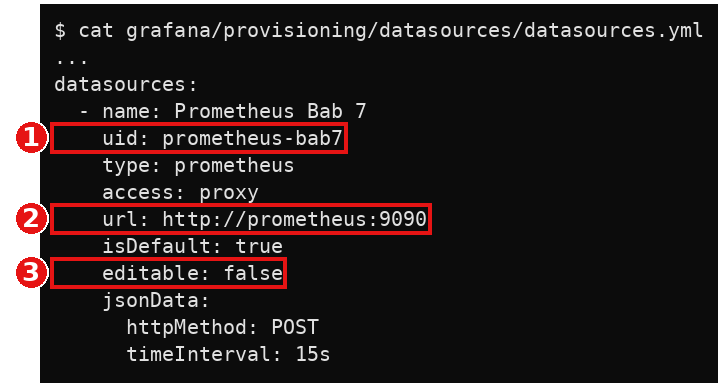

<sub>Isi file dari cheatsheet: datasources.yml (bagian Prometheus)</sub>

**[1]**  "Datasource **Prometheus Bab 7** dibuat otomatis dari file, dengan **uid tetap prometheus-bab7**. Panel dashboard merujuk ke uid ini."

**[2]**  "URL **http://prometheus:9090**: Grafana memanggil Prometheus lewat nama service di network internal."

**[3]**  "**editable: false**: datasource tidak bisa diubah lewat UI."

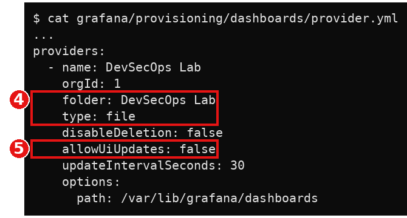

<sub>Isi file dari cheatsheet: provider.yml</sub>

**[4]**  "Dashboard dibaca dari **file** dan masuk folder **DevSecOps Lab**."

**[5]**  "**allowUiUpdates: false**: perubahan lewat UI **tidak bisa disimpan**. Perubahan harus lewat file JSON yang ditinjau di version control."

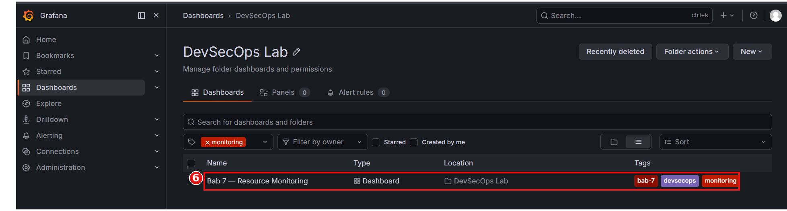

<sub>Grafana kamu (Sabtu): dashboard ter-provision di folder DevSecOps Lab</sub>

**[6]**  "Hasilnya: dashboard **Bab 7 — Resource Monitoring** sudah ada di folder DevSecOps Lab tanpa dibuat manual."

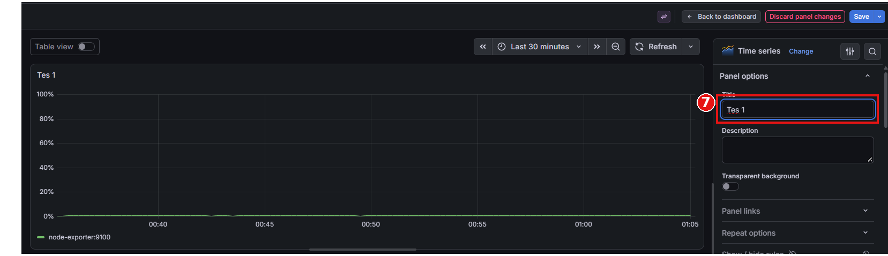

<sub>Grafana kamu (24 Nov): judul panel diubah lewat UI</sub>

**[7]**  "Saya coba ubah judul panel lewat UI (Edit panel → Title)."

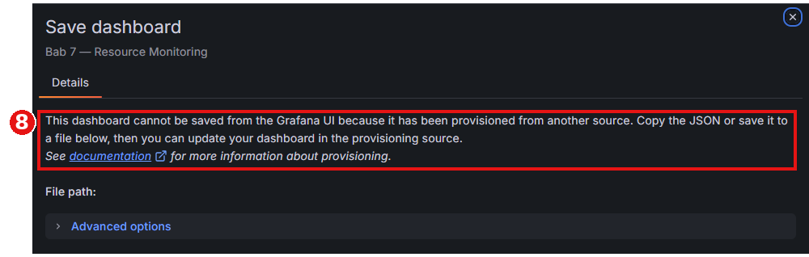

<sub>Grafana kamu (24 Nov): hasil klik Save</sub>

**[8]**  "Waktu Save, Grafana menolak: **This dashboard cannot be saved from the Grafana UI because it has been provisioned from another source**. Perubahan harus lewat file JSON-nya. Lalu saya klik **Discard**."

**Pengaturan akses Grafana**: login admin dari **.env** (GRAFANA_ADMIN_USER/PASSWORD), akses anonim dimatikan, port hanya **127.0.0.1:3000**.

> 🔑 **Kata kunci:** datasource & dashboard dari file (provisioning) → uid prometheus-bab7 → allowUiUpdates false = UI tidak bisa simpan → ubah lewat file

> 🗣️ **Contoh penjelasan:** Datasource dan dashboard dibuat otomatis dari file. Karena allowUiUpdates false, perubahan lewat UI tidak bisa disimpan, jadi semua perubahan harus lewat file yang ditinjau. Akses Grafana pakai admin dari .env, anonim mati, dan hanya di 127.0.0.1.

#### C. Pertanyaan lanjutan: No data padahal query jalan di Prometheus?

- 1. Cek **rentang waktu** dashboard (kanan atas).

- 2. Jalankan query yang sama di **Grafana Explore** dengan datasource yang sama.

- 3. Cek **datasource**: uid panel harus prometheus-bab7; tes koneksinya di Connections.

- 4. Kalau panel pakai recording rule: cek **Status > Rules** di Prometheus.

- 5. Cek label/selector, lalu **docker compose logs grafana**.

> 📘 **Sumber perintah:** cheatsheet Bab 7, **Troubleshooting**: baris "Grafana menampilkan No data".

---

## Soal 23 — Tahap C — Recovery dan transaksi yang gagal

> 💡 **Demonstrasi:** Kembalikan mode ke **none** dan kirim transaksi baru. Tunjukkan bahwa transaksi baru menjadi VERIFIED, sementara transaksi insiden tetap FAILED. Jelaskan mengapa, lalu usulkan strategi retry terkontrol atau dead-letter queue.  
> **Pertanyaan lanjutan:** Apa risikonya jika transaksi FAILED diproses ulang otomatis tanpa idempotensi?

#### A. Tunjukkan

```bash
./scripts/set-incident.sh none
./scripts/demo-normal.sh
docker compose exec -T app-db \
  psql -U "$APP_DB_ADMIN_USER" -d "$APP_DB_NAME" \
  -c 'SELECT public_id, status, attempt, failure_code, request_id FROM registrations ORDER BY submitted_at DESC;'
```

> 📘 **Sumber perintah:** PMB **README.md**: bagian **Skenario 2** (kalimat "Pendaftaran yang sudah FAILED sengaja tidak diproses ulang secara otomatis") dan **Menelusuri request ID** (query app-db).

#### B. Jelaskan (ikuti nomor merah)

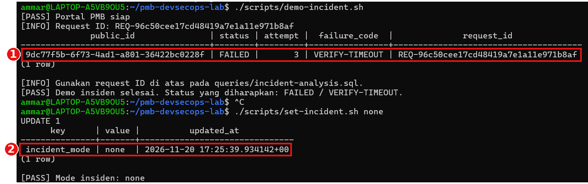

<sub>Terminal kamu (Jumat): transaksi insiden FAILED lalu mode none</sub>

**[1]**  "Transaksi insiden: **FAILED**, VERIFY-TIMEOUT."

**[2]**  "Mode dikembalikan ke **none**."

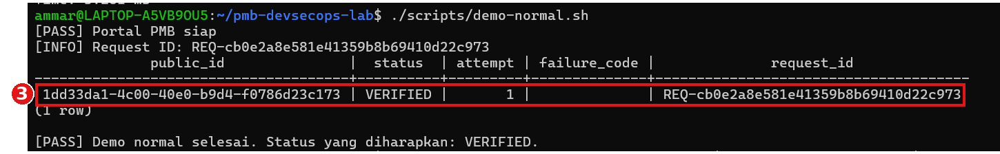

<sub>Terminal kamu (Jumat): transaksi baru VERIFIED</sub>

**[3]**  "Transaksi **baru**: **VERIFIED**. Sistem sudah pulih."

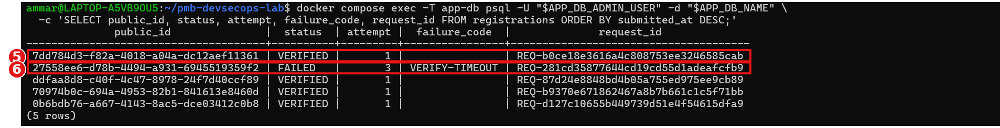

<sub>Terminal kamu (24 Nov): demo-incident → none → demo-normal → query app-db</sub>

**[5]**  "Transaksi **terbaru** setelah mode none: **VERIFIED**."

**[6]**  "Transaksi insiden tepat di bawahnya **tetap FAILED**, attempt 3, VERIFY-TIMEOUT. Tidak berubah sendiri walaupun sistem sudah pulih."

**[4]**  "Kenapa yang FAILED tetap FAILED? Worker hanya memproses pendaftaran **baru**. FAILED adalah status akhir, **sengaja** tidak diproses ulang otomatis supaya tidak ada pemrosesan ulang tanpa kendali."

**Usulan:**

- **Retry terkontrol**: batas jumlah percobaan, jeda yang makin panjang (backoff), dan **kunci idempotensi**.

- **Dead-letter queue (DLQ)**: transaksi gagal dipindah ke antrean khusus, ditinjau manusia, lalu dikirim ulang dengan sengaja setelah penyebabnya diperbaiki. Analogi: **kotak surat retur** di kantor pos.

> 🔑 **Kata kunci:** none → transaksi baru VERIFIED → insiden tetap FAILED (status akhir, sengaja) → usul retry terkontrol / DLQ

> 🗣️ **Contoh penjelasan:** Setelah mode none, transaksi baru jadi VERIFIED, jadi sistem pulih. Transaksi insiden tetap FAILED karena itu status akhir dan sengaja tidak diproses ulang otomatis. Usul saya dead-letter queue: transaksi gagal ditinjau dulu, lalu dikirim ulang dengan sengaja, atau retry terkontrol dengan batas dan kunci idempotensi.

#### C. Pertanyaan lanjutan: risiko proses ulang otomatis tanpa idempotensi?

"Transaksi yang sama bisa diproses **dua kali**: verifikasi ganda, efek samping ganda (misalnya email atau tagihan terkirim dua kali), status tidak konsisten. Retry massal juga bisa membebani dependency yang sedang bermasalah (**retry storm**)."

> 💡 **Idempotensi** = diproses berkali-kali hasilnya tetap sama. Analogi: tombol lift ditekan 5 kali, lift tetap datang sekali.

---

## Ringkasan 1 halaman — baca sebelum masuk

| Soal | Kata kunci (ucapkan berurutan) |
|---|---|
| 3 | Table fluentbit tanpa schema → login fluentbit_user → search_path logs, public (init script) → logs.fluentbit |
| 3 lanjutan | SHOW search_path → \dt logs.* → nama DB/user → \dn+ logs → init hanya saat volume kosong |
| 8 | BEFORE: ILIKE 1 (bocor) → filter Lua → AFTER: ILIKE 0 + [REDACTED] |
| 8 lanjutan | docker logs cache, stdout, sumber (.env/kode), ekspor/backup/screenshot → redaksi dekat sumber |
| 14 | counter selalu naik (odometer) → rate() laju per detik (speedometer) → 0..1 per core |
| 14 lanjutan | rate butuh ≥ 2 sampel; scrape 15 s; jendela 5m belum terisi |
| 18 | provisioning dari file → uid prometheus-bab7 → allowUiUpdates false → UI tak bisa simpan |
| 18 lanjutan | rentang waktu → Explore → datasource uid → Rules → label → logs grafana |
| 23 | none → baru VERIFIED → insiden tetap FAILED (sengaja) → DLQ / retry terkontrol |
| 23 lanjutan | tanpa idempotensi: diproses dua kali, efek ganda, retry storm |

> 💡 Kalau lupa kalimatnya: tunjuk bukti di layar, sebut angkanya, lalu bilang "artinya ...".
