# Paket D — Naskah Demo + Evidence

*Soal 4, 9, 12, 15, 24 • disusun dari screenshot dan terminal kamu sendiri • perintah dicocokkan dengan cheatsheet*

**Cara pakai.** Tiap soal: **A. Tunjukkan** (jalankan perintah), **B. Jelaskan** (ikuti nomor merah di gambar), **C. Jawab lanjutan**. 📘 = di mana perintah itu ada di cheatsheet/README, jadi besok tinggal salin. 🟧 = soal yang belum pernah kamu jalankan.

| Soal | Lab / tab | Status | Satu kalimat inti |
|---|---|---|---|
| 4 | Bab 6 (Tab 2) | sudah | fluentbit_user cuma INSERT+SELECT (ar) dan USAGE+CREATE (UC). |
| 9 | Bab 6 (Tab 2) | sudah | Preview dulu, ekspor+checksum, hapus bertahap/partisi, catat; awas UTC. |
| 12 | Bab 7 (Tab 1) | sudah | check config = file valid; test rules = logika alert benar; bukan target/notifikasi. |
| 15 | Bab 7 (Tab 1) | sudah | Rule dan rumus manual hampir sama; beda karena waktu evaluasi/pengelompokan. |
| 24 | PMB (Tab 3) | sudah (Jumat) | log-db mati → aplikasi tetap jalan → retry → backlog masuk setelah pulih. |

> ⚠️ Bab 6 dan PMB **tidak bisa hidup bersamaan** (port 24224 dan 2020 sama). Kerjakan soal Bab 6 dulu, lalu **docker compose down** di Bab 6, baru **docker compose up -d** di PMB. Bab 7 boleh hidup terus.

---

## Soal 4 — Least privilege akun ingest

> 💡 **Demonstrasi:** Tunjukkan **\dp logs.fluentbit** dan **\dn+ logs** di psql. Jelaskan hak apa saja yang dimiliki akun Fluent Bit dan mengapa.  
> **Pertanyaan lanjutan:** Apa beda dampaknya bila kredensial fluentbit_user bocor dibanding kredensial admin?

#### A. Tunjukkan

```bash
docker compose exec -T postgres-db \
  psql --username "$POSTGRES_USER" --dbname "$POSTGRES_DB" --command '\dp logs.fluentbit'
docker compose exec -T postgres-db \
  psql --username "$POSTGRES_USER" --dbname "$POSTGRES_DB" --command '\dn+ logs'
```

> 📘 **Sumber perintah:** Perintah \dp dan \dn+ disebut di cheatsheet Bab 6, **Troubleshooting** (baris "Galat permission pada schema/table"). Asal hak-haknya: **Kotak Script 4 — init/01-init-logging.sh**, baris **GRANT USAGE, CREATE ON SCHEMA logs** dan **GRANT SELECT, INSERT ON TABLE logs.fluentbit**.

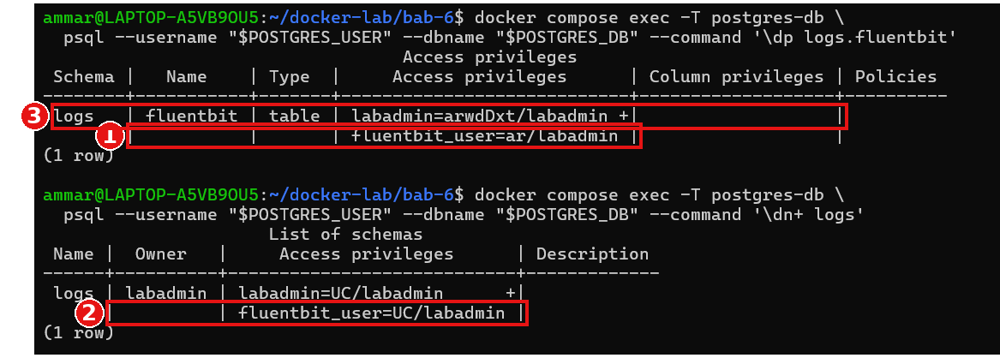

<sub>Terminal kamu (24 Nov): \dp dan \dn+</sub>

#### B. Jelaskan

| Huruf | Arti |
|---|---|
| a | INSERT (append, menambah baris) |
| r | SELECT (read, membaca) |
| w / d / D | UPDATE / DELETE / TRUNCATE |
| U | USAGE schema (boleh masuk schema) |
| C | CREATE (boleh membuat objek di schema) |

**[1]**  "Di tabel logs.fluentbit, fluentbit_user cuma punya **ar**: **INSERT** dan **SELECT**. Tidak ada w, d, D, jadi **tidak bisa mengubah atau menghapus** log lama."

**[2]**  "Di schema logs, fluentbit_user punya **UC**: **USAGE** (boleh masuk) dan **CREATE** (plugin pgsql bisa membuat tabel sendiri)."

**[3]**  "labadmin sebagai pemilik punya semua huruf. Akun admin tidak dipakai Fluent Bit."

> 💡 Kalau connect-bab6.sh (soal 20) pernah dijalankan, bisa muncul juga **grafana_reader=r**: Grafana cuma boleh membaca.

> 🔑 **Kata kunci:** fluentbit_user: tabel ar (INSERT+SELECT), schema UC → tidak bisa UPDATE/DELETE → least privilege

> 🗣️ **Contoh penjelasan:** Akun Fluent Bit hanya bisa masuk schema logs, membuat objek di sana, membaca, dan menambah baris ke logs.fluentbit. Tidak punya UPDATE, DELETE, atau TRUNCATE. Jadi kalau akun ini dipakai, log lama tidak bisa diubah atau dihapus. Ini least privilege: hak secukupnya untuk tugasnya.

> 💡 Analogi: fluentbit_user = **kurir** yang boleh memasukkan surat ke kotak arsip dan melihatnya, tapi tidak punya kunci untuk membuang arsip. Admin = pemilik gedung.

#### C. Pertanyaan lanjutan: bocor fluentbit_user vs admin?

| Yang bocor | Penyerang bisa |
|---|---|
| fluentbit_user | **menyisipkan log palsu** (mengotori bukti), **membaca** isi log, membuat objek di schema logs. **Tidak bisa** menghapus/mengubah log lama. |
| admin (labadmin) | **kendali penuh**: menghapus bukti, mengubah data, membuat role baru, mematikan audit. |

---

## Soal 9 — Kebijakan retensi

> 💡 **Demonstrasi:** Tunjukkan query DELETE yang dikomentari di **analysis.sql**, lalu rancang kebijakan retensi tujuh hari.  
> **Pertanyaan lanjutan:** Kolom time bertipe **TIMESTAMP WITHOUT TIME ZONE**. Apa risikonya untuk retensi dan korelasi waktu?

#### A. Tunjukkan

```bash
grep -n -B1 -A2 "DELETE" queries/analysis.sql
docker compose exec -T postgres-db \
  psql --username "$POSTGRES_USER" --dbname "$POSTGRES_DB" \
  --command "SELECT count(*) AS akan_dihapus FROM logs.fluentbit WHERE time < (now() AT TIME ZONE 'UTC') - INTERVAL '7 days';"
```

> 📘 **Sumber perintah:** Query DELETE: cheatsheet Bab 6, **Kotak Script 6 — queries/analysis.sql** (bagian paling bawah, "Contoh retensi"). Bisa juga dibuka dengan **nano queries/analysis.sql**. Query preview (count) tidak ada di cheatsheet.

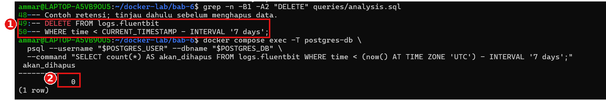

<sub>Terminal kamu (24 Nov): DELETE yang dikomentari dan preview</sub>

**[1]**  "Query DELETE ini **sengaja dikomentari** (diawali --) supaya tidak terhapus tanpa sengaja. Isinya: hapus log yang lebih tua dari 7 hari."

**[2]**  "Sebelum menghapus, saya **preview dulu** dengan count, jadi tahu berapa baris yang akan hilang. Di lab ini hasilnya 0, karena data baru beberapa hari."

#### B. Rancangan kebijakan 7 hari

- **Simpan 7 hari** di database aktif.

- Sebelum dihapus: **ekspor + checksum** kalau masih perlu sebagai bukti. Log insiden yang sedang diselidiki **dikecualikan** (legal hold).

- **Otomatis tiap hari** di luar jam sibuk (cron / pg_cron).

- **Hapus bertahap** (batch kecil) supaya tabel tidak terkunci lama. Untuk data besar: **partisi per hari**, lalu buang partisi lama.

- **Catat** setiap penghapusan: kapan, berapa baris, oleh siapa.

> 🔑 **Kata kunci:** DELETE dikomentari → preview count → ekspor+checksum → otomatis harian → bertahap/partisi → catat → awas UTC

> 🗣️ **Contoh penjelasan:** Query DELETE di analysis.sql sengaja dikomentari. Kebijakan saya: simpan 7 hari, preview dulu jumlahnya, ekspor dan beri checksum kalau masih dibutuhkan, kecualikan log insiden, jalankan otomatis tiap hari secara bertahap, dan catat setiap penghapusan.

#### C. Pertanyaan lanjutan: risiko TIMESTAMP WITHOUT TIME ZONE?

"Kolomnya **tidak menyimpan zona waktu**. Isinya UTC, tapi tidak ada tandanya. Risikonya: (1) **retensi bisa bergeser** beberapa jam kalau zona waktu sesi database bukan UTC, misalnya WIB, bergeser 7 jam; (2) **korelasi salah baca** dengan sumber lain, misalnya Prometheus pakai UTC sedangkan Grafana pakai waktu browser (WIB). Solusinya pakai **TIMESTAMPTZ** atau dokumentasikan bahwa semuanya UTC."

> 💡 Kamu sudah lihat sendiri: di lab, kolom time menunjukkan 14:13 padahal jam laptopmu 21:13 WIB. Selisih 7 jam = UTC vs WIB.

---

## Soal 12 — Validasi rule sebelum dijalankan

> 💡 **Demonstrasi:** Jalankan **promtool check config** dan **promtool test rules** dengan perintah **docker compose run ... --entrypoint /bin/promtool** dari cheatsheet. Jelaskan apa yang dibuktikan dan tidak dibuktikan oleh masing-masing.  
> **Pertanyaan lanjutan:** Ubah **eval_time** pada rules.test.yml menjadi **1m**. Apakah test masih lulus, dan mengapa?

#### A. Tunjukkan

```bash
docker compose run --rm --no-deps \
  --entrypoint /bin/promtool \
  prometheus \
  check config /etc/prometheus/prometheus.yml

docker compose run --rm --no-deps \
  --entrypoint /bin/promtool \
  prometheus \
  test rules /etc/prometheus/tests/rules.test.yml
```

> 📘 **Sumber perintah:** cheatsheet Bab 7, **Kotak Perintah B — Memberi Izin dan Memvalidasi Konfigurasi** (bagian "Validasi konfigurasi dan rule Prometheus").

#### B. Jelaskan (ikuti nomor merah)

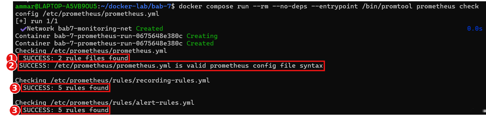

<sub>Terminal kamu (Sabtu): promtool check config</sub>

**[1]**  "check config menemukan **2 rule files**."

**[2]**  "**prometheus.yml valid**: penulisannya benar."

**[3]**  "Masing-masing file rule berisi **5 rules** (5 recording rule, 5 alert rule) dan bisa dimuat."

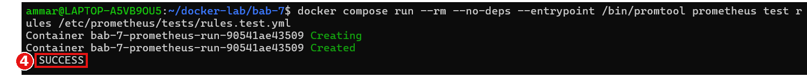

<sub>Terminal kamu (Sabtu): promtool test rules</sub>

**[4]**  "test rules **SUCCESS**: dengan data palsu (up 1 lalu 0), pada menit ke-2 alert **TargetDown firing** dengan label dan annotation yang benar. Jadi **logika** alert-nya benar."

|  | Membuktikan | TIDAK membuktikan |
|---|---|---|
| check config | file prometheus.yml & rule **valid** dan bisa dimuat | target benar-benar bisa dijangkau, jaringan benar |
| test rules | **logika** rule benar dengan data palsu | target asli, notifikasi terkirim, threshold-nya tepat |

> 🔑 **Kata kunci:** check config = penulisan valid (2 file, 5+5 rule) → test rules = logika TargetDown benar (data palsu) → bukan target asli / notifikasi

> 🗣️ **Contoh penjelasan:** check config membuktikan prometheus.yml valid dan dua file rule bisa dimuat. test rules membuktikan logika TargetDown benar: dengan data palsu up 1 lalu 0, di menit ke-2 alert firing. Yang tidak dibuktikan: target asli bisa dijangkau, jaringan benar, notifikasi terkirim, dan threshold-nya tepat.

#### C. Pertanyaan lanjutan: eval_time diubah 1m?

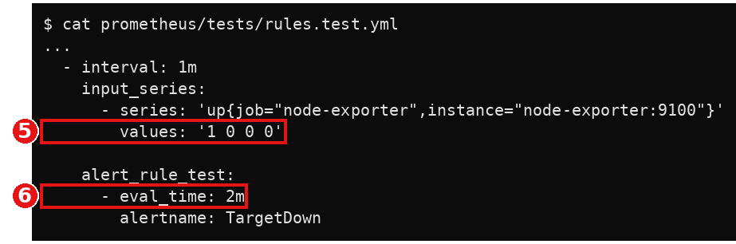

<sub>Isi file dari cheatsheet (Kotak Script 7): rules.test.yml</sub>

**[5]**  "Data palsu: menit 0 = **1**, menit 1 = **0**, menit 2 = **0**."

**[6]**  "eval_time aslinya **2m**."

"**Tidak lulus.** up baru 0 di menit 1. Karena rule-nya **for: 1m**, di menit 1 alert masih **pending**, baru **firing** di menit 2. promtool hanya mencocokkan alert yang **firing**, jadi di menit 1 hasilnya kosong dan tidak cocok dengan exp_alerts."

Bukti langsung (lalu **wajib dikembalikan**):

```bash
sed -i 's/eval_time: 2m/eval_time: 1m/' prometheus/tests/rules.test.yml
docker compose run --rm --no-deps --entrypoint /bin/promtool prometheus \
  test rules /etc/prometheus/tests/rules.test.yml          # harapannya FAILED
sed -i 's/eval_time: 1m/eval_time: 2m/' prometheus/tests/rules.test.yml
grep eval_time prometheus/tests/rules.test.yml               # pastikan kembali 2m
```

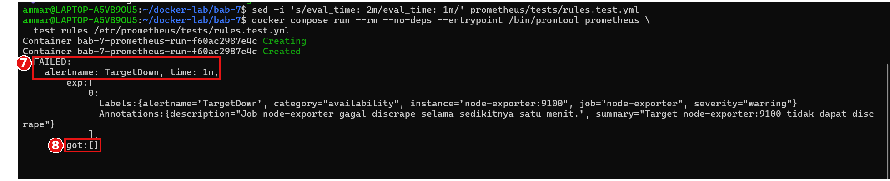

<sub>Terminal kamu (24 Nov): eval_time 1m → FAILED</sub>

**[7]**  "Dengan eval_time 1m: **FAILED**, alert TargetDown di menit 1 tidak sesuai harapan."

**[8]**  "**got:[]** = di menit 1 tidak ada alert firing, karena masih pending."


<sub>Terminal kamu (24 Nov): dikembalikan ke 2m</sub>

**[9]**  "File test sudah saya **kembalikan ke 2m**."

> 💡 Hubungannya dengan soal 17: sama persis seperti negative test. up 0 → **pending** dulu → setelah 1 menit baru **firing**.

---

## Soal 15 — Recording rule CPU host

> 💡 **Demonstrasi:** Tunjukkan definisi **instance:node_cpu_utilisation:ratio_rate5m** di recording-rules.yml, lalu hitung hal yang sama secara manual dengan **100 - avg(rate(node_cpu_seconds_total{mode="idle"}[5m])) * 100**. Bandingkan hasilnya.  
> **Pertanyaan lanjutan:** Jika hasil manual dan rule berbeda sedikit, apa saja penyebab yang mungkin?

#### A. Tunjukkan

```bash
grep -A5 "instance:node_cpu_utilisation" prometheus/rules/recording-rules.yml
# Prometheus (Query), jalankan keduanya:
instance:node_cpu_utilisation:ratio_rate5m * 100
100 - avg(rate(node_cpu_seconds_total{mode="idle"}[5m])) * 100
```

> 📘 **Sumber perintah:** Definisi rule: cheatsheet Bab 7, **Kotak Script 5 — prometheus/rules/recording-rules.yml**. Query rule × 100: **Kotak Perintah D**. Rumus manual: dari bunyi soal.

#### B. Jelaskan (ikuti nomor merah)

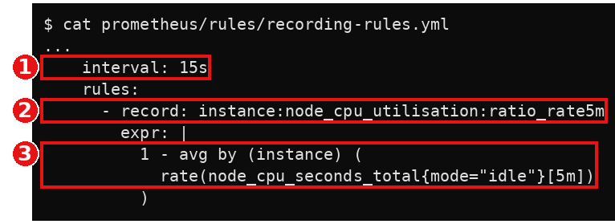

<sub>Isi file dari cheatsheet: recording rule CPU host</sub>

**[1]**  "Rule dihitung **tiap 15 detik** (interval: 15s)."

**[2]**  "Nama rule: **instance:node_cpu_utilisation:ratio_rate5m**, artinya utilisasi CPU per instance, rasio, jendela 5 menit."

**[3]**  "Rumusnya: **1 dikurangi rata-rata porsi idle** per instance. Kalau idle 97%, utilisasi 3%."

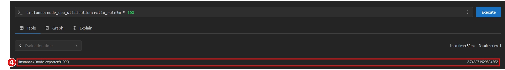

<sub>Prometheus kamu (Sabtu): hasil rule × 100</sub>

**[4]**  "Hasil rule × 100 = sekitar **2,7%**."

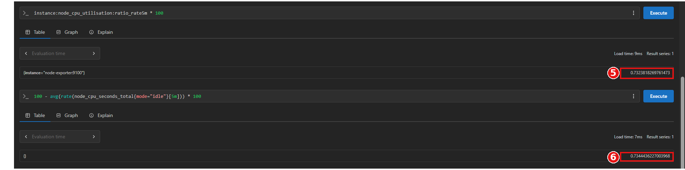

<sub>Prometheus kamu (24 Nov): rule vs rumus manual</sub>

**[5]**  "Recording rule × 100 = **0,7324**%."

**[6]**  "Rumus manual = **0,7344**%. Selisihnya cuma 0,002, jadi **hampir sama**. CPU host sedang santai, kurang dari 1%."

> 🔑 **Kata kunci:** rule tiap 15 s → 1 - avg idle → disimpan jadi series baru → manual dihitung saat query → hampir sama

> 🗣️ **Contoh penjelasan:** Recording rule menghitung 1 dikurangi rata-rata porsi idle per instance setiap 15 detik, lalu menyimpannya sebagai series baru. Rumus manual menghitung hal yang sama saat query dijalankan. Karena hanya ada satu instance, hasilnya hampir sama.

> 💡 Analogi: recording rule = **rangkuman yang sudah dicatat** tiap 15 detik. Rumus manual = **menghitung sendiri saat itu juga**.

#### C. Pertanyaan lanjutan: kenapa beda sedikit?

- **Waktu evaluasi beda**: rule menyimpan hasil terakhir (tiap 15 s), manual dihitung tepat saat query.

- **Pengelompokan**: rule pakai **avg by (instance)**, manual pakai avg tanpa by. Bisa beda kalau instance lebih dari satu.

- Resolusi grafik (step), pembulatan, data baru masuk di antara dua evaluasi, atau evaluasi rule yang gagal.

---

## Soal 24 — Tahap D — Resilience logging saat log-db mati

> 💡 **Demonstrasi:** Hentikan **log-db**, hasilkan transaksi baru, amati retry dan penggunaan buffer Fluent Bit, jalankan kembali log-db, lalu buktikan backlog terkirim. Tunjukkan juga cara Anda mendeteksi record ganda.  
> **Pertanyaan lanjutan:** Apa yang terjadi bila buffer Fluent Bit mencapai batas 256 MB?

#### A. Tunjukkan

```bash
docker compose exec -T log-db psql -U "$LOG_DB_ADMIN_USER" -d "$LOG_DB_NAME" \
  -tAc "SELECT count(*) FROM logs.fluentbit;"          # catat jumlah awal
docker compose stop log-db
./scripts/demo-normal.sh                               # catat Request ID
docker compose logs --tail 100 fluent-bit              # failed to flush chunk, retry
docker compose start log-db && sleep 20
docker compose exec -T log-db psql -U "$LOG_DB_ADMIN_USER" -d "$LOG_DB_NAME" \
  -tAc "SELECT count(*) FROM logs.fluentbit;"          # bertambah
```

> 📘 **Sumber perintah:** PMB **README.md**, bagian **Pengujian pipeline**, langkah 1–6 "Pengujian buffering database log". Perintah count dan query Request ID tidak tertulis lengkap di README, pakai pola query app-db/log-db di bagian "Menelusuri request ID".

#### B. Jelaskan (ikuti nomor merah)

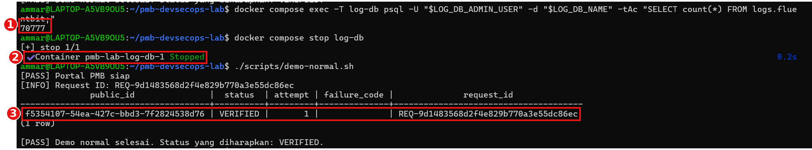

<sub>Terminal kamu (Jumat): jumlah awal, stop log-db, transaksi baru</sub>

**[1]**  "Jumlah awal record di log-db: **70777**."

**[2]**  "log-db **dimatikan**."

**[3]**  "Transaksi baru tetap **VERIFIED**. Aplikasi tetap melayani walaupun database log mati."

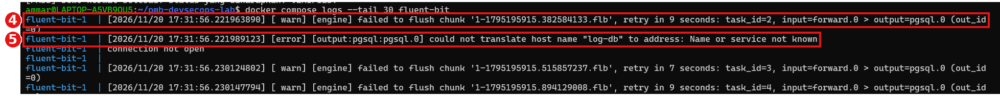

<sub>Terminal kamu (Jumat): log Fluent Bit saat log-db mati</sub>

**[4]**  "Fluent Bit: **failed to flush chunk** → dijadwalkan retry. Chunk ditahan di buffer filesystem."

**[5]**  "Error: **could not translate host name "log-db"**. Container log-db mati, jadi namanya tidak bisa ditemukan."

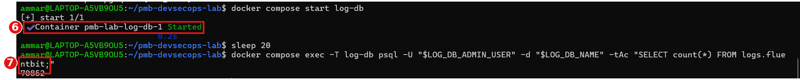

<sub>Terminal kamu (Jumat): start log-db, jumlah akhir</sub>

**[6]**  "log-db **dinyalakan** lagi."

**[7]**  "Jumlah naik jadi **70852** (+75). Backlog yang ditahan sudah terkirim."

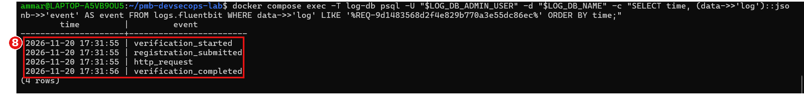

<sub>Terminal kamu (Jumat): event transaksi saat log-db mati</sub>

**[8]**  "Keempat event transaksi yang dibuat **saat log-db mati** sekarang ada di log-db. Tidak ada yang hilang."

> 💡 Kenaikan 75, bukan cuma 4, karena selain event transaksi ada juga **http_request** dan access log healthcheck yang terus dibuat setiap beberapa detik selama log-db mati.

#### Deteksi record ganda

```bash
docker compose exec -T log-db psql -U "$LOG_DB_ADMIN_USER" -d "$LOG_DB_NAME" -c "
  SELECT (data->>'log')::jsonb->>'request_id' AS rid,
         (data->>'log')::jsonb->>'event'      AS ev,
         (data->>'log')::jsonb->>'timestamp'  AS ts,
         count(*)
  FROM logs.fluentbit
  WHERE data->>'log' LIKE '{%'
  GROUP BY 1, 2, 3 HAVING count(*) > 1;"
```

> 💡 Query duplikat ini tidak ada di README, jadi salin dari sini.

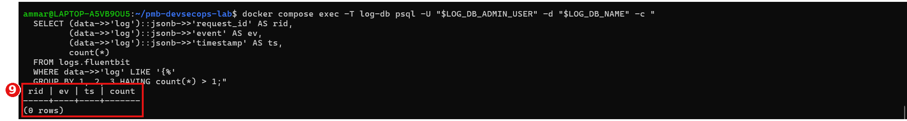

<sub>Terminal kamu (24 Nov): cek duplikat di log-db PMB</sub>

**[9]**  "Hasilnya **0 rows**: tidak ada duplikat. Saya kelompokkan berdasarkan **request_id + event + timestamp** aplikasi. Kalau count lebih dari 1, itu duplikat akibat retry (at-least-once). 0 rows = tidak ada duplikat."

> 💡 Filter LIKE '{%' supaya hanya log JSON aplikasi yang diubah ke jsonb; access log gunicorn bukan JSON dan akan error kalau di-cast.

> ⚠️ Sebutkan juga: di laptopmu fluent-bit.conf PMB ditambah **Retry_Limit no_limits** (MANIFEST checksum menunjukkan file itu berubah). Tanpa itu, batas retry bawaan bisa membuat chunk dibuang kalau database mati lama.

> 🔑 **Kata kunci:** count awal → stop log-db → transaksi tetap VERIFIED → failed to flush + retry → start → count naik → event ada → cek duplikat

> 🗣️ **Contoh penjelasan:** Saat log-db mati, aplikasi tetap melayani dan Fluent Bit mencatat failed to flush chunk lalu retry. Setelah log-db hidup, jumlah record naik dan keempat event transaksi yang dibuat saat database mati muncul. Untuk duplikat, saya kelompokkan berdasarkan request_id, event, dan timestamp; kalau count lebih dari 1 berarti duplikat karena retry.

#### C. Pertanyaan lanjutan: buffer mencapai 256 MB?

"Itu batas **storage.total_limit_size 256M** untuk output pgsql. Kalau penuh, Fluent Bit **membuang chunk paling lama** untuk output itu, artinya **ada log yang hilang**. Pantau dengan metrik dropped dan retries_failed, siapkan kapasitas disk, dan pasang alert sebelum batas tercapai."

> 💡 Analogi: gudang penuh, barang paling lama dibuang supaya barang baru bisa masuk.

---

## Ringkasan 1 halaman — baca sebelum masuk

| Soal | Kata kunci (ucapkan berurutan) |
|---|---|
| 4 | \dp: fluentbit_user=ar (INSERT+SELECT); \dn+: UC (USAGE+CREATE) → tidak bisa UPDATE/DELETE |
| 4 lanjutan | bocor fluentbit_user: log palsu + baca; bocor admin: kendali penuh, hapus bukti |
| 9 | DELETE dikomentari → preview count → ekspor+checksum → harian, bertahap/partisi → catat |
| 9 lanjutan | tanpa zona waktu → retensi geser 7 jam (WIB), korelasi salah → TIMESTAMPTZ / dokumentasi UTC |
| 12 | check config: valid (2 file, 5+5) → test rules: logika TargetDown benar → bukan target/notifikasi |
| 12 lanjutan | eval_time 1m → masih pending (for 1m) → promtool cuma cocokkan firing → FAILED |
| 15 | rule tiap 15 s = 1 - avg idle → manual saat query → 0,7324 vs 0,7344 = hampir sama |
| 15 lanjutan | waktu evaluasi, by (instance), step/pembulatan, data baru, rule gagal |
| 24 | 70777 → stop → VERIFIED → failed to flush/retry → start → 70852 → 4 event ada → cek duplikat |
| 24 lanjutan | 256 MB penuh → chunk paling lama dibuang → log hilang → pantau dropped, alert |

> 💡 Kalau lupa kalimatnya: tunjuk bukti di layar, sebut angkanya, lalu bilang "artinya ...".
