# Paket E — Naskah Demo + Evidence

*Soal 7, 10, 19, 20, 25 • disusun dari screenshot dan terminal kamu sendiri • perintah dicocokkan dengan cheatsheet*

**Cara pakai.** Tiap soal: **A. Tunjukkan** (jalankan perintah), **B. Jelaskan** (ikuti nomor merah di gambar), **C. Jawab lanjutan**. 📘 = di mana perintah itu ada di cheatsheet/README, jadi besok tinggal salin. 🟧 = soal yang belum pernah kamu jalankan.

| Soal | Lab / tab | Status | Satu kalimat inti |
|---|---|---|---|
| 7 | Bab 6 (Tab 2) | sudah | Catat sebelum-sesudah: 1 run = 60 di DB, input, dan proc_records. |
| 10 | Bab 6 (Tab 2) | sudah | \copy rentang waktu ke CSV → sha256sum → sertakan UTC, query, jumlah baris. |
| 19 | Bab 7 (Tab 1) | sudah | Status TSDB: metrik cAdvisor biasanya series terbanyak; label = cardinality. |
| 20 | Bab 6 + Bab 7 | sudah | connect-bab6.sh sambungkan PostgreSQL Bab 6 ke Grafana (read-only). |
| 25 | PMB (Tab 3) | sudah (Jumat) | Secret bersih, checksum config, no nama/email di log, request_id divalidasi. |

> ⚠️ Bab 6 dan PMB **tidak bisa hidup bersamaan** (port 24224 dan 2020 sama). Kerjakan soal Bab 6 dulu, lalu **docker compose down** di Bab 6, baru **docker compose up -d** di PMB. Bab 7 boleh hidup terus.

> 💡 Soal 20 butuh Bab 6 **dan** Bab 7 hidup bersamaan.

---

## Soal 7 — Rekonsiliasi kelengkapan event

> 💡 **Demonstrasi:** Hitung event per service yang tersimpan di PostgreSQL. Setiap generator menghasilkan 20 baris per run. Bandingkan dengan jumlah yang dihasilkan dan yang diterima Fluent Bit, lalu jelaskan setiap selisih.  
> **Pertanyaan lanjutan:** Bagaimana mendeteksi dan mencegah record ganda?

#### A. Tunjukkan (urutan penting: sebelum → generate → sesudah)

```bash
# 1. SEBELUM
docker compose exec -T postgres-db psql --username "$POSTGRES_USER" --dbname "$POSTGRES_DB" \
  --command "SELECT tag, count(*) FROM logs.fluentbit GROUP BY tag;"
curl -fsS http://127.0.0.1:2020/api/v1/metrics | python3 -m json.tool | grep -E '"records"|"proc_records"'
# 2. hasilkan event
./scripts/generate-logs.sh && sleep 25
# 3. SESUDAH: ulangi dua perintah di langkah 1
```

> 📘 **Sumber perintah:** Query per tag: cheatsheet Bab 6, **Kotak Perintah E** (analysis.sql query 2). Metrics: **Kotak Perintah D**. Generate: **Kotak Perintah C**. Angka 20 per run: **Kotak Script 7 — generate-logs.sh** / compose.yaml generator.

#### B. Jelaskan (ikuti nomor merah)

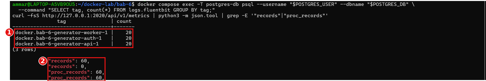

<sub>Terminal kamu (24 Nov): SEBELUM generate</sub>

**[1]**  "SEBELUM: tiap generator **20** record di PostgreSQL (total 60)."

**[2]**  "Fluent Bit: input **records 60** = output **proc_records 60**. Sama dengan isi database."

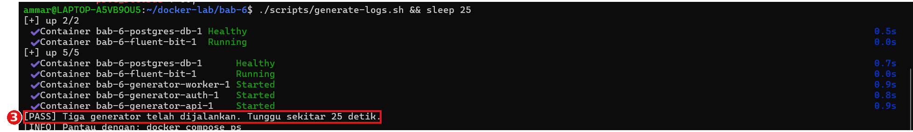

<sub>Terminal kamu (24 Nov): generate-logs</sub>

**[3]**  "Saya jalankan satu run: 3 generator × 20 = **60** event baru."

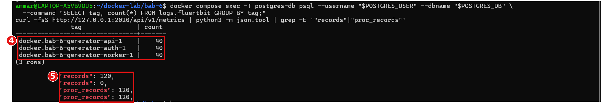

<sub>Terminal kamu (24 Nov): SESUDAH generate</sub>

**[4]**  "SESUDAH: tiap generator **40**, naik tepat **+20**. Total naik **+60**."

**[5]**  "Input **120** (+60) dan proc_records **120** (+60). Dihasilkan 60, diterima 60, disimpan 60: **tidak ada selisih**."

|  | Dihasilkan | PostgreSQL | Input Fluent Bit | proc_records pgsql |
|---|---|---|---|---|
| Sebelum |  | 60 | 60 | 60 |
| Sesudah | +60 | 120 (+60) | 120 (+60) | 120 (+60) |

| Kalau ada selisih | Penjelasan |
|---|---|
| DB lebih banyak | kemungkinan **duplikat** akibat retry (at-least-once) |
| DB lebih sedikit | cek retries_failed / dropped_records, atau data **masih di buffer** |
| input metrics ≠ total DB | metrics **reset** saat Fluent Bit restart; karena itu yang dibandingkan **selisih** sebelum-sesudah |

> 🔑 **Kata kunci:** 1 run = 3 × 20 = 60 → DB +60, input +60, proc_records +60 → lebih = duplikat, kurang = buffer/drop

> 🗣️ **Contoh penjelasan:** Satu run menghasilkan 3 kali 20 = 60 event. Sebelum generate, database 20 per generator dan Fluent Bit 60. Sesudahnya 40 per generator, input dan proc_records 120. Semuanya naik tepat 60, jadi tidak ada yang hilang dan tidak ada duplikat.

#### C. Pertanyaan lanjutan: deteksi dan cegah record ganda?

```bash
docker compose exec -T postgres-db psql --username "$POSTGRES_USER" --dbname "$POSTGRES_DB" \
  --command "SELECT tag, time, data->>'log' AS log, count(*)
             FROM logs.fluentbit GROUP BY tag, time, data HAVING count(*) > 1;"
```

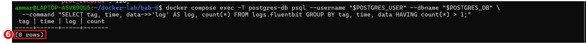

<sub>Terminal kamu (24 Nov): cek duplikat</sub>

**[6]**  "**0 rows**: tidak ada record ganda."

"**Deteksi**: duplikat akibat retry punya **tag, waktu, dan isi yang identik**. Kelompokkan berdasarkan tag, time, dan data, cari yang muncul lebih dari sekali. 0 rows = tidak ada duplikat."

> ⚠️ Query versi lama (GROUP BY container_id + log) **salah**: hasilnya 60 baris count 2. Itu **bukan duplikat**. generate-logs memakai ulang container yang sama (statusnya **Started**, bukan Created), jadi container_id dan isi lognya sama untuk dua run yang berbeda, padahal waktunya berbeda. Pelajaran: log yang isinya sama belum tentu duplikat. Kunci duplikat harus memasukkan **waktu** atau **ID event unik**.

"**Pencegahan**: beri setiap event **ID unik** di sumbernya, lalu indeks unik atau **INSERT ... ON CONFLICT DO NOTHING** di tujuan."

> 📘 **Sumber perintah:** cheatsheet Bab 6, **Troubleshooting**: baris "Ada record ganda — karakteristik at-least-once saat retry".

---

## Soal 10 — Ekspor log sebagai evidence

> 💡 **Demonstrasi:** Ekspor log satu rentang waktu ke file dengan **\copy (SELECT ...) TO ...**, lalu buat checksumnya dengan **sha256sum**. Jelaskan informasi apa yang harus menyertai ekspor itu.  
> **Pertanyaan lanjutan:** Kapan PostgreSQL tidak lagi cocok sebagai backend log utama?

#### A. Tunjukkan

```bash
mkdir -p reports
Q="SELECT time, tag, data FROM logs.fluentbit"
Q="$Q WHERE time >= '2026-11-24 00:00' AND time < '2026-11-25 00:00' ORDER BY time"
docker compose exec -T postgres-db psql --username "$POSTGRES_USER" --dbname "$POSTGRES_DB" \
  --command "\copy ($Q) TO STDOUT WITH CSV HEADER" > reports/export-logs.csv
wc -l reports/export-logs.csv
sha256sum reports/export-logs.csv | tee reports/export-logs.csv.sha256
sha256sum -c reports/export-logs.csv.sha256
```

> 📘 **Sumber perintah:** **Tidak ada di cheatsheet Bab 6**. Pola psql sama dengan Kotak Perintah E. Ketik/salin dari sini.

> 💡 Rentang waktu dalam **UTC** (WIB dikurangi 7 jam). Kalau ujian pagi WIB, data hari itu ada di tanggal UTC sebelumnya, jadi pakai rentang 2 hari seperti di bawah.

#### B. Jelaskan (ikuti nomor merah)

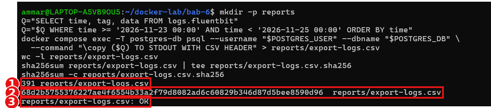

<sub>Terminal kamu (24 Nov): ekspor CSV + checksum</sub>

**[1]**  "**391** baris = 1 baris header + **390 record** dalam rentang itu."

**[2]**  "**Checksum SHA-256**: sidik jari file. Kalau 1 karakter berubah, checksumnya berubah total."

**[3]**  "**OK**: file belum berubah sejak checksum dibuat."

> 💡 TO STDOUT + tanda > membuat file tersimpan di **laptop**, bukan di dalam container. Variabel Q supaya perintah \copy (harus satu baris) tetap pendek.

**Informasi yang wajib menyertai ekspor**:

- Rentang waktu **beserta zona waktunya (UTC)**.

- **Query persis**, sumber data (database labdb, tabel logs.fluentbit), **jumlah baris**.

- **Siapa** yang mengekspor dan **kapan**, versi tool.

- **Checksum SHA-256**, disimpan di tempat yang tidak bisa diubah sembarangan.

> 🔑 **Kata kunci:** \copy rentang (UTC) → CSV di laptop → wc -l → sha256sum → -c OK → sertakan UTC, query, jumlah, siapa/kapan, checksum

> 🗣️ **Contoh penjelasan:** Saya ekspor log satu rentang waktu ke CSV, lalu buat checksum SHA-256 sebagai sidik jari file. Yang wajib menyertai: rentang waktu dan zona waktunya, query persis, jumlah baris, siapa dan kapan mengekspor, dan checksumnya.

#### C. Pertanyaan lanjutan: kapan PostgreSQL tidak cocok lagi?

"Saat **volume dan laju ingest sangat tinggi**, **retensi panjang**, butuh **pencarian teks bebas** yang cepat, sumbernya banyak, atau butuh **skala horizontal**. Alternatifnya Loki, OpenSearch, atau ClickHouse."

---

## Soal 19 — Cardinality dan storage TSDB

> 💡 **Demonstrasi:** Jalankan **curl -fsS http://127.0.0.1:9090/api/v1/status/tsdb** atau buka **Status > TSDB**, lalu tunjukkan metric dengan series terbanyak di lab Anda.  
> **Pertanyaan lanjutan:** Label cAdvisor mana yang layak dipertahankan, dan mana yang sebaiknya dibuang?

#### A. Tunjukkan

```bash
# Cara 1 (paling mudah): browser http://127.0.0.1:9090 → Status → TSDB Status
# Cara 2:
curl -fsS http://127.0.0.1:9090/api/v1/status/tsdb | python3 -m json.tool > /tmp/tsdb.json
sed -n '/seriesCountByMetricName/,/]/p' /tmp/tsdb.json
sed -n '/labelValueCountByLabelName/,/]/p' /tmp/tsdb.json
```

> 📘 **Sumber perintah:** Perintah ada di **bunyi soal**. Cheatsheet Bab 7, **Troubleshooting**: baris "Penggunaan disk Prometheus tumbuh — Status TSDB; cardinality" dan "Panel container memiliki cardinality tinggi".

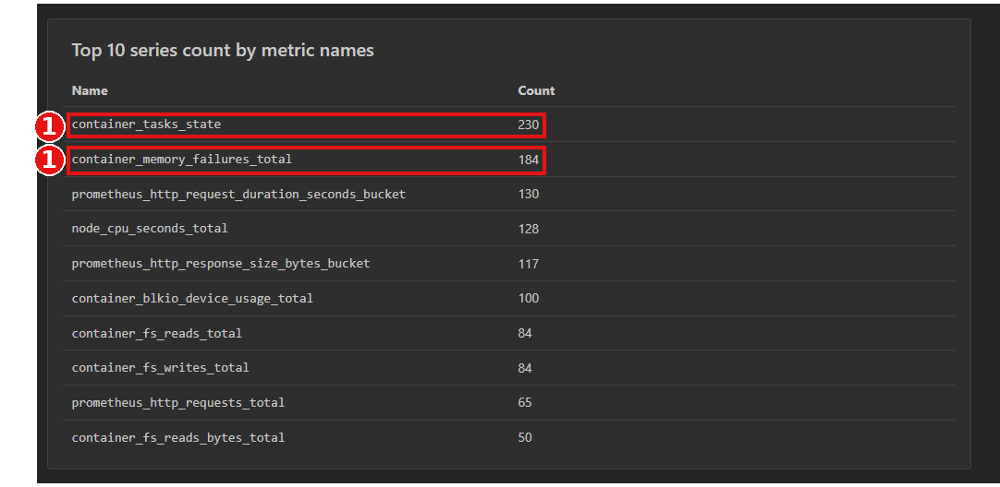

<sub>Prometheus kamu (24 Nov): Status → TSDB Status</sub>

#### B. Jelaskan

**[1]**  "Series terbanyak di lab saya: **container_tasks_state** (230) dan **container_memory_failures_total** (184). Keduanya dari **cAdvisor**, karena setiap container punya banyak kombinasi label."

**[2]**  "**Series** = satu kombinasi unik label. Contoh: 1 metrik × 10 container × 8 CPU = 80 series."

**[3]**  "**Cardinality** = banyaknya kombinasi itu. Makin banyak nilai unik label, makin banyak memori dan disk Prometheus."

> 💡 Analogi: metrik = **nama kolom absen**; label = **kelas, jurusan, angkatan**. Kalau ditambah label "nomor HP", tiap siswa jadi baris unik dan absennya meledak.

> 🔑 **Kata kunci:** TSDB Status → series terbanyak (biasanya container_*) → series = kombinasi label → cardinality tinggi = memori/disk naik

> 🗣️ **Contoh penjelasan:** Metrik dengan series terbanyak di lab saya adalah container_tasks_state dengan 230 series, dari cAdvisor. Jumlah series ditentukan kombinasi label. Makin banyak nilai unik sebuah label, makin banyak memori dan disk yang dipakai Prometheus.

#### C. Pertanyaan lanjutan: label cAdvisor dipertahankan / dibuang?

| Pertahankan (stabil, berguna) | Buang (berubah-ubah / terlalu banyak) |
|---|---|
| name / label service Compose, instance, job, cpu, mode | **id** (path cgroup), image ID/digest, sebagian besar **container_label_*** |

"Caranya pakai **metric_relabel_configs** dengan **labeldrop** di prometheus.yml. Detail yang sangat unik lebih cocok disimpan di log."

---

## Soal 20 — Integrasi log Bab 6 ke Grafana

> 💡 **Demonstrasi:** Jalankan **./scripts/connect-bab6.sh**, lalu di Grafana Explore query logs.fluentbit dengan **$__timeFilter(time)** pada rentang yang sama dengan kenaikan CPU container. Jelaskan apa yang dilakukan script dan apa yang bisa Anda simpulkan.  
> **Pertanyaan lanjutan:** Script gagal dengan pesan "Network Bab 7 belum tersedia". Apa artinya, dan bagaimana memperbaikinya?

#### A. Tunjukkan (Tab 1, folder Bab 7; Bab 6 juga harus hidup)

```bash
docker compose --profile load up -d load-generator     # buat kenaikan CPU
./scripts/connect-bab6.sh
# di Tab 2 (Bab 6): ./scripts/generate-logs.sh   -> supaya ada log baru di rentang yang sama
# setelah ±2 menit:
docker compose --profile load stop load-generator
docker compose --profile load rm -f load-generator
```

> 📘 **Sumber perintah:** cheatsheet Bab 7, **Kotak Perintah G — Integrasi Opsional Log Bab 6** (script + query Grafana). Isi script: **Kotak Script 12 — scripts/connect-bab6.sh**. Load: **Kotak Perintah E**.

Di Grafana: **Explore** → datasource **PostgreSQL Logs Bab 6** → tombol **Code**, lalu tempel query dari Kotak Perintah G:

```bash
SELECT time AS "time", tag,
       replace(data ->> 'container_name', '/', '') AS container_name,
       data ->> 'source' AS source,
       data ->> 'log' AS log_message
FROM logs.fluentbit
WHERE $__timeFilter(time)
ORDER BY time DESC
LIMIT 200;
```

#### B. Jelaskan (ikuti nomor merah)

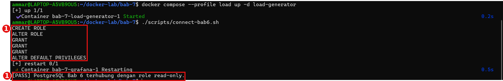

<sub>Terminal kamu (24 Nov): load generator + connect-bab6.sh</sub>

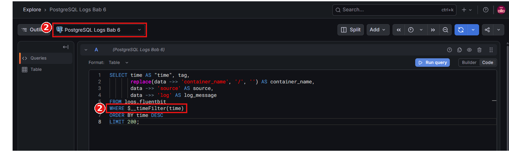

<sub>Grafana kamu (24 Nov): Explore, datasource PostgreSQL Logs Bab 6</sub>

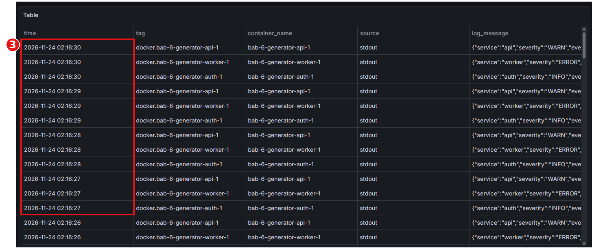

<sub>Grafana kamu (24 Nov): hasil query log Bab 6</sub>

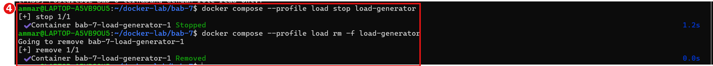

<sub>Terminal kamu (24 Nov): load generator dihentikan</sub>

**[4]**  "Setelah selesai, load generator dihentikan dan dihapus."

#### Apa yang dilakukan script

| # | Yang dilakukan connect-bab6.sh |
|---|---|
| 1 | memuat .env Bab 7 dan Bab 6 |
| 2 | cek container PostgreSQL Bab 6 berjalan; cek network **bab7-monitoring-net** ada |
| 3 | menyambungkan postgres-db Bab 6 ke network Bab 7 dengan **alias postgres-db** |
| 4 | membuat role **grafana_reader**: hanya CONNECT, USAGE, SELECT (**read-only**) |

**[1]**  "Script membuat role (CREATE ROLE), memberi hak baca (GRANT), lalu **PASS: PostgreSQL Bab 6 terhubung dengan role read-only**. Grafana di-restart supaya datasource-nya aktif."

**[2]**  "Di Explore pakai datasource **PostgreSQL Logs Bab 6**. **$__timeFilter(time)** membuat query mengikuti rentang waktu Grafana."

**[3]**  "Log Bab 6 tampil di Grafana. Jamnya **02:16 WIB**, padahal di database tersimpan 19:16 UTC; Grafana otomatis mengubah ke waktu browser. Kesimpulan: metrik CPU dan log bisa dilihat di **rentang waktu yang sama**, tapi itu baru **korelasi waktu**, belum tentu sebab-akibat."

> 💡 Ingat: kolom time = UTC, Grafana menampilkan waktu browser (WIB). Grafana mengurus konversinya, tapi hati-hati kalau membandingkan manual.

> 🔑 **Kata kunci:** connect-bab6 → sambung postgres-db ke bab7-monitoring-net → grafana_reader read-only → $__timeFilter → korelasi waktu ≠ sebab-akibat

> 🗣️ **Contoh penjelasan:** Script menyambungkan PostgreSQL Bab 6 ke network Bab 7 dengan alias postgres-db dan membuat akun grafana_reader yang hanya bisa membaca. Di Explore, $__timeFilter membuat log mengikuti rentang waktu yang sama dengan kenaikan CPU. Kesimpulannya korelasi waktu, belum tentu sebab-akibat.

#### C. Pertanyaan lanjutan: "Network Bab 7 belum tersedia"?

"Artinya network **bab7-monitoring-net** belum ada, biasanya karena **stack Bab 7 belum dinyalakan** atau baru di-down. Perbaikannya: **cd ~/docker-lab/bab-7 && docker compose up -d**, cek **docker network ls | grep bab7**, lalu jalankan script lagi."

> 📘 **Sumber perintah:** Pesan error itu tertulis di **Kotak Script 12**: "[FAIL] Network Bab 7 belum tersedia. Jalankan stack Bab 7 dahulu."

---

## Soal 25 — Privasi, kepercayaan, dan kesiapan produksi

> 💡 **Demonstrasi:** Tunjukkan hasil pemeriksaan secret dan data pribadi pada log yang tersimpan, serta checksum konfigurasi yang dipakai saat pengujian. Jelaskan mengapa nama dan email tidak dimasukkan ke structured log, dan bagaimana Anda memperlakukan request_id dari client.  
> **Pertanyaan lanjutan:** Kontrol apa yang harus ditambahkan sebelum arsitektur serupa dipakai di produksi?

#### A. Tunjukkan

```bash
./scripts/verify.sh                             # pemeriksaan secret
sha256sum -c MANIFEST.sha256 | grep -v ': OK'    # checksum konfigurasi
./scripts/collect-evidence.sh && cat reports/config-sha256.txt
docker compose run --rm --no-deps registration-api \
  python -m unittest discover -s tests -v       # redaction & request_id
```

> 📘 **Sumber perintah:** PMB **README.md**: bagian **Pengujian pipeline** (verify.sh, unittest) dan **Evidence** (collect-evidence.sh, "status transaksi tanpa nama dan email", "checksum konfigurasi"). MANIFEST.sha256 ada di folder PMB.

#### B. Jelaskan (ikuti nomor merah)

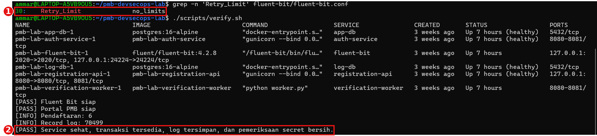

<sub>Terminal kamu (Jumat): verify.sh</sub>

**[1]**  "fluent-bit.conf PMB saya ubah: **Retry_Limit no_limits** (supaya chunk tidak dibuang kalau log-db mati lama)."

**[2]**  "verify.sh: **pemeriksaan secret bersih**. Script mencari pola password, authorization, bearer, cookie, session secret, api key di semua log, dan tidak ketemu."

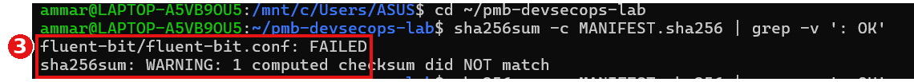

<sub>Terminal kamu (Jumat): checksum MANIFEST</sub>

**[3]**  "Checksum: hanya **fluent-bit.conf FAILED**, karena memang saya ubah (Retry_Limit). File lain sama persis dengan paket asli. Jujur menyebut perubahan = evidence bisa dipercaya."

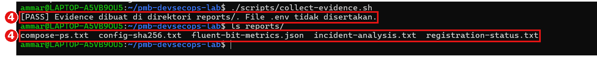

<sub>Terminal kamu (Jumat): collect-evidence</sub>

**[4]**  "collect-evidence membuat **config-sha256.txt** (checksum konfigurasi saat pengujian) dan file evidence lain, **tanpa .env**."

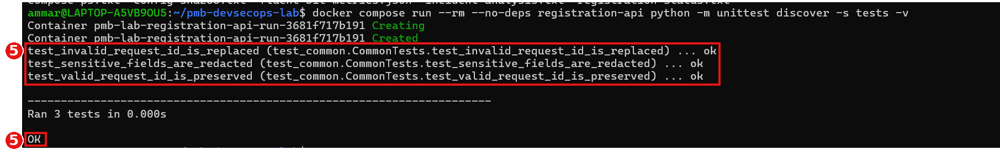

<sub>Terminal kamu (Jumat): unit test</sub>

**[5]**  "Unit test **OK**: request_id tidak valid **diganti**, field sensitif **di-redact**, request_id valid **dipertahankan**."

#### Kenapa nama dan email tidak masuk log?

"Karena **data pribadi**. Log dibaca banyak orang (operator, Grafana), disalin ke ekspor dan backup, dan disimpan lama. Untuk melacak cukup **request_id** dan **registration_id**. Data pribadi cukup di database transaksi yang aksesnya dibatasi."

#### Bagaimana request_id dari client diperlakukan?

"request_id dari client **tidak langsung dipercaya**. Kalau formatnya tidak valid (misalnya berisi teks aneh atau terlalu panjang), **diganti** dengan ID baru buatan server. Ini mencegah orang menyisipkan isi palsu ke log. Dibuktikan oleh unit test [5]."

> 🔑 **Kata kunci:** verify: secret bersih → MANIFEST: cuma fluent-bit.conf berubah (Retry_Limit) → config-sha256 → no nama/email → request_id divalidasi

> 🗣️ **Contoh penjelasan:** verify.sh memeriksa pola secret di semua log dan hasilnya bersih. Checksum menunjukkan hanya fluent-bit.conf yang berbeda dari paket asli karena saya menambahkan Retry_Limit. Nama dan email tidak masuk log karena data pribadi. request_id dari client divalidasi dan diganti kalau tidak valid, dibuktikan oleh unit test.

#### C. Pertanyaan lanjutan: kontrol sebelum produksi?

- **TLS** di semua koneksi; **secret manager** dan rotasi credential (bukan .env).

- **RBAC dan audit**: siapa boleh membaca log/dashboard; segmentasi jaringan.

- **Retensi, partisi, backup**, penyimpanan log yang tidak bisa diubah.

- **Monitoring pipeline logging** (retry, drop, ukuran buffer) dengan alert, plus Alertmanager.

- **Event ID unik** untuk deduplikasi, sinkronisasi waktu (NTP), image dipin dengan digest dan di-scan.

---

## Ringkasan 1 halaman — baca sebelum masuk

| Soal | Kata kunci (ucapkan berurutan) |
|---|---|
| 7 | 20→40 per tag, 60→120 input & proc_records → semua +60 → tidak hilang, tidak ganda (0 rows) |
| 7 lanjutan | GROUP BY tag, time, data HAVING > 1 → isi sama ≠ duplikat → cegah: event ID unik + ON CONFLICT |
| 10 | \copy rentang UTC → CSV → sha256sum → -c OK → sertakan UTC, query, jumlah, siapa/kapan |
| 10 lanjutan | volume besar, retensi panjang, full-text, skala horizontal → Loki/OpenSearch/ClickHouse |
| 19 | TSDB Status → container_tasks_state 230 (cAdvisor) → series = kombinasi label → cardinality |
| 19 lanjutan | pertahankan name/instance/job/cpu; buang id, image digest, container_label_* (labeldrop) |
| 20 | connect-bab6 → sambung network + grafana_reader read-only → $__timeFilter → korelasi ≠ sebab-akibat |
| 20 lanjutan | network bab7-monitoring-net belum ada → up -d Bab 7 → jalankan ulang script |
| 25 | secret bersih → checksum (cuma fluent-bit.conf) → no nama/email → request_id divalidasi (unit test) |
| 25 lanjutan | TLS, secret manager, RBAC/audit, retensi/backup, monitoring pipeline, event ID, NTP, image digest |

> 💡 Kalau lupa kalimatnya: tunjuk bukti di layar, sebut angkanya, lalu bilang "artinya ...".
